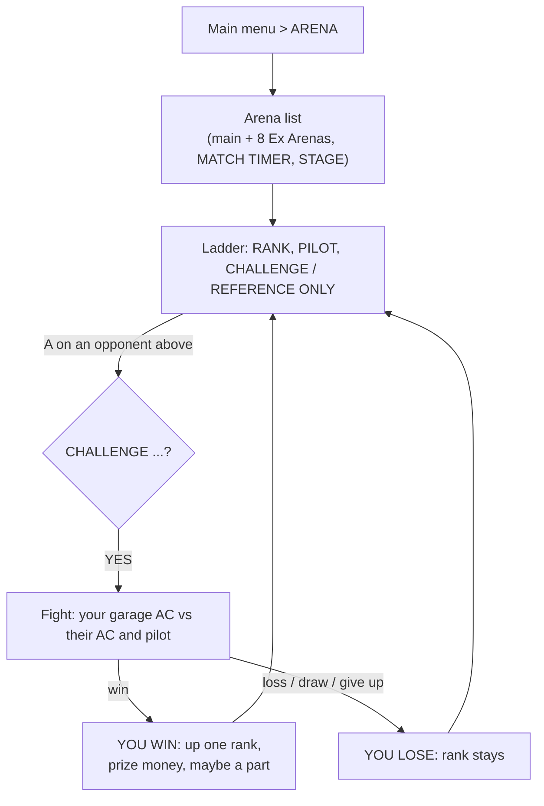

# The Arena (roadmap step 7)

Main menu > **ARENA**: Master of Arena's ranked ladders, fought with the
garage's own AC, paying prize money and prize parts into the garage.

- Rules: `src/gen1/acr_gen1_arena.{h,c}` (no OS calls), tests in
  `tests/test_gen1_arena.c`.
- Screens: `src/platform/sdl3/arena.{h,c}`; standings saved to
  `arena.toml` next to the garage save (`ACR_ARENA_FILE` overrides).
- Opponents and prizes come from the import (`<import>/arena/`, the same
  files Rogue Arena reads; `prize_money` and `prize_part` are already in
  them). No re-import needed if Rogue Arena works.

## How it plays

## Rules

From the AC1Recomp mapping (`docs/mapping/arena-prizes.md`,
`menus-screens.md`, `moa_arena_run_boot.c`):

| Rule | |
|---|---|
| Main arena | 50 places: ranks 1-15 the **ranked** list, 16-50 the **sub arena** (L1 / R1 flips the pages) |
| Sub arena | each opponent is beaten once and can't be fought again ("BEATEN") |
| Ranked list | opens at the top of the sub arena (rank 16) |
| Winning | anyone above can be challenged; a win moves you **up one rank** |
| Prize money | every win, the opponent's own amount; credits cap at 99,999,999 |
| Prize parts | 23 parts on the disc; the part goes into the garage (+1 copy, +1 more for paired back weapons) |
| Champion / Guest | their part comes only once every opponent there is beaten |
| Ex Arenas 1-4 | need the matching legs (humanoid, four legs, reverse joint, caterpillar) |
| Blocked fights | the game's messages: "REFERENCE ONLY", "UNABLE TO CHALLENGE AT THIS TIME", "REQUIRES A SPECIFIC LEG TYPE", "YOUR EQUIPMENT IS INCOMPLETE" |
| Timer | 2:00, 5:00 or NONE (set on the arena list) |

## Our own choices (the mapping doesn't say) — easy to change

1. **Who drops when you win:** the beaten opponent drops to just below you;
   the ones in between move up one. This keeps the sub arena from ever
   leaving you with only beaten opponents above you.
2. **Parts only the first time** an opponent is beaten; money every time.
3. **When the Ex Arenas open:** the four leg arenas at main-arena rank 15;
   Champion, Guest and FromSoft at main-arena rank 1; Master once Champion,
   Guest and FromSoft have each been topped. (`ACR_ARENA_UNLOCK=1` opens
   them all for testing.)
4. **A draw counts as a loss** (as in Rogue Arena).
5. **Prize 22** (Champion's) is a part outside the ten part tables; the
   result screen says the build doesn't have it yet.

## Testing

- `ACR_ROGUE_AUTOWIN=1` now also wins Arena fights a moment after they
  start (headless screen tests).
- Tested here with a made-up import (no disc): list, ladder, challenge,
  fight with and without a clock, win, pay-out and save. Real opponents,
  their ACs on the ladder panel and the prize part names need the disc.

## Still to do (step 7)

- Stages: the stages' own out-of-area boxes (a test boundary stands in),
  Garden Plaza and Night City, stage lights. Needs the disc to test.
- The VS screen before an Arena fight (Rogue Arena has one), opponent
  emblems on the ladder, the "Opponent unavailable, default win" rule
  (opponents killed in missions) once missions count.
