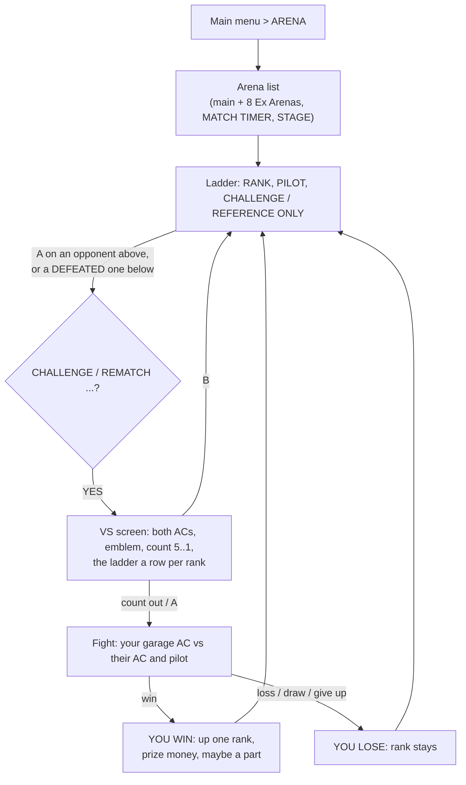

# The Arena (roadmap step 7)

Main menu > **ARENA**: Master of Arena's ranked ladders, fought with the
garage's own AC, paying prize money and prize parts into the garage.

- Rules: `src/gen1/acr_gen1_arena.{h,c}` (no OS calls), tests in
  `tests/test_gen1_arena.c`.
- Screens: `src/platform/sdl3/arena.{h,c}`; standings saved to
  `arena.toml` next to the garage save (`ACR_ARENA_FILE` overrides).
- Opponents and prizes come from the import (`<import>/arena/`, the same
  files Rogue Arena reads; `prize_money` and `prize_part` are already in
  them). No re-import needed if Rogue Arena works.

## How it plays

## Rules

From the AC1Recomp mapping (`docs/mapping/arena-prizes.md`,
`menus-screens.md`, `moa_arena_run_boot.c`):

| Rule | |
|---|---|
| Main arena | 50 places: ranks 1-15 the **ranked** list, 16-50 the **sub arena** (L1 / R1 flips the pages) |
| Sub arena | in the game each opponent is beaten once and can't be fought again; here they can, as a rematch (below) |
| Ranked list | opens at the top of the sub arena (rank 16) |
| Winning | anyone above can be challenged; a win moves you **up one rank** |
| Prize money | the first win over an opponent only (user, 2026-11-24); credits cap at 99,999,999 |
| Prize parts | 23 parts on the disc; the part goes into the garage (+1 copy, +1 more for paired back weapons) |
| Champion / Guest | their part comes only once every opponent there is beaten |
| Ex Arenas 1-4 | need the matching legs (humanoid, four legs, reverse joint, caterpillar) |
| Blocked fights | the game's messages: "REFERENCE ONLY", "UNABLE TO CHALLENGE AT THIS TIME", "REQUIRES A SPECIFIC LEG TYPE", "YOUR EQUIPMENT IS INCOMPLETE" |
| Timer | 2:00, 5:00 or NONE (set on the arena list) |

## Our own choices (the mapping doesn't say) — easy to change

1. **Who drops when you win:** the beaten opponent drops to just below you;
   the ones in between move up one. This keeps the sub arena from ever
   leaving you with only beaten opponents above you.
2. **Parts only the first time** an opponent is beaten (money too: user's call).
3. **When the Ex Arenas open:** the four leg arenas at main-arena rank 15;
   Champion, Guest and FromSoft at main-arena rank 1; Master once Champion,
   Guest and FromSoft have each been topped. (`ACR_ARENA_UNLOCK=1` opens
   them all for testing.)
4. **A draw counts as a loss** (as in Rogue Arena).
5. **Prize 22** (Champion's) is a part outside the ten part tables; the
   result screen says the build doesn't have it yet.
6. **Rematches** (user, 2026-11-25): whoever you beat drops to just
   below you and is marked **DEFEATED** on the ladder. You can fight them
   again in any arena, for fun: no rank change, no money, no part (it still
   counts in the ARENA REPORT, and Ex Arenas still need their legs). Beating
   the pilot just above you means taking their place; beating someone
   further up still moves you up one rank (the game's rule).

## The VS screen

Every Arena fight opens with Rogue Arena's VS screen (AC1Recomp's design;
the code is shared, `src/platform/sdl3/vs_screen.{h,c}`): your AC (blue,
left), the opponent's (red, right) with their emblem from your disc behind
it (`<import>/arena/<AA-name>/<RR>-emblem.tim`), RANK badges, FOR RANK n
(REMATCH for a rematch), the count "UNITS DEPLOY IN 5..1" and the stage;
then the hangar shutters close and the fight starts. A skips the count, B
goes back to the ladder.

The bottom band is the arena's **whole ladder, a row per rank** (user,
2026-11-25), in columns of ten: your row where you stand (blue, "YOU"),
the opponent's row (red), the defeated struck through in red. In the main
arena the ranked list's numbers are gold, with a gold line under rank 15.

Your own emblem: none yet. The garage has no EDIT EMBLEM and the save keeps
no emblem, so the left box shows your AC only; it will pick up your
emblem once EDIT EMBLEM is built.

## Testing

- `ACR_ROGUE_AUTOWIN=1` now also wins Arena fights a moment after they
  start (headless screen tests).
- Checked with the real disc (2026-11-25, Master of Arena USA): ladder
  names (Nine-Ball / Hustler One at rank 1 ... Angst / No Problem at 49),
  their ACs and emblems on the ladder panel, VS screen, a real win over Top
  Cap paying 10,000 C and HD-H10, a rematch, the Humanoid Ex Arena. All 23
  prize ids resolve to the part names in AC1Recomp's `arena-prizes.md`
  (prize 22 has no part table, as before).

## Still to do (step 7)

- Stages: the stages' own out-of-area boxes (a test boundary stands in),
  Garden Plaza and Night City, stage lights. Needs the disc to test.
- The "Opponent unavailable, default win" rule (opponents killed in
  missions) once missions count.
- The player's emblem on the VS screen once EDIT EMBLEM exists.
