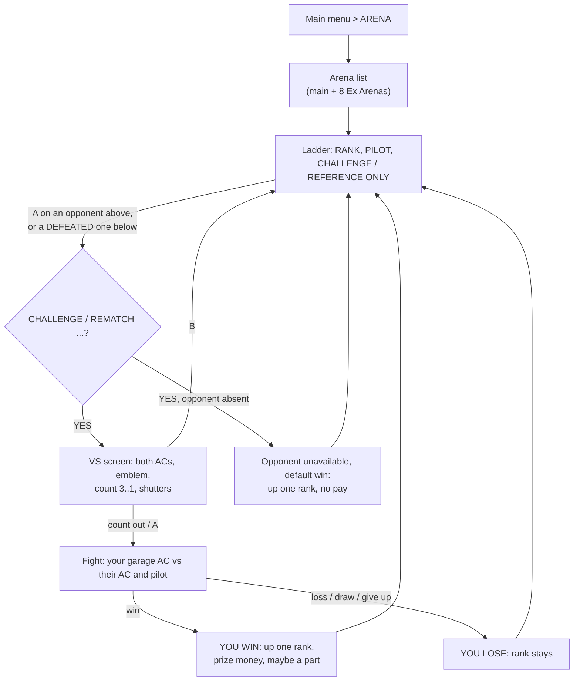

# The Arena (roadmap step 7)

Main menu > **ARENA**: Master of Arena's ranked ladders, fought with the
garage's own AC, paying prize money and prize parts into the garage.

- Rules: `src/gen1/acr_gen1_arena.{h,c}` (no OS calls), tests in
  `tests/test_gen1_arena.c`.
- Screens: `src/platform/sdl3/arena.{h,c}`; standings saved to
  `arena.toml` next to the garage save (`ACR_ARENA_FILE` overrides).
- Opponents and prizes come from the import (`<import>/arena/`, the same
  files Rogue Arena reads; `prize_money` and `prize_part` are already in
  them). No re-import needed if Rogue Arena works.

## Project Phantasma's arena is the main Arena (user, 2026-11-27)

The normal Arena is **Project Phantasma's 49 + 1** (arena number 9). Master of Arena's ladders stay as
Ex Arenas: its 50-place main ladder (number 0, now called MASTER OF ARENA, still ranked 1-15 + sub arena)
and its eight Ex Arenas (1-8). Master of Arena keeps the low numbers so old `arena.toml` standings and
Rogue Arena runs carry on unchanged. The game takes both discs (content rebase: arena, opponents, AI,
and later parts, stages and missions come from Phantasma; the fight rules stay Master of Arena's).

- **Import.** Either disc can go first, on the first-run screen, `acr-import <disc> <folder>`, by dropping
  it on the ARENA screen, or with its row "A: ADD PROJECT PHANTASMA DISC". A Phantasma disc's archives go
  to `<import>/pp/unpacked`, its arena to `<import>/arena/09-phantasma` (`tools/acr_import/acr_arena_pp.c`).
- **Data** (ACG1PLUS `docs/research/mapping/content-data.md` 4, `ai.md` 3): builds, names, emblems, prize
  money and the nine prize parts from `MENU_TIM.T` 282-483. Back weapons 17 and up are one higher in
  Master of Arena's numbering (checked by name against the disc). Prize ids 23-31 = Phantasma's 0-8.
- **AI:** Phantasma keeps 49 AI records of 60 bytes in its arena engine. **Record n belongs to opponent
  number n = its starting rank − 1** (confirmed, ACG1PLUS `ai.md` §3a: the menu stores the opponent's
  list number as the AI record number; the record follows the opponent, not the rank it holds now).
  The whole record goes into the opponent's file (`ai_record_pp`) and drives the original brain
  (docs/AI.md). The editor rows read from it (fly = desire C, blade = lunge chance, lock = from the
  reaction delay; no fire-chance, dodge or range fields: 75 / 50 / 50) only matter to the utility brain.
- **Names:** four "Panzern" pilots carry a symbol from Phantasma's font (bytes 0xA2-0xA5); written as
  Panzern I-IV (a guess at which is which).
- **Unlocks (ours):** Phantasma's arena from the start, one list (no sub arena); MASTER OF ARENA once
  Phantasma's is topped (or at once without the Phantasma disc); its Ex Arenas as before, from its ladder.
- **Rogue Arena** still draws from Master of Arena's arenas only (parity with AC1Recomp).

## How it plays

## Rules

From the AC1Recomp mapping (`docs/mapping/arena-prizes.md`,
`menus-screens.md`, `moa_arena_run_boot.c`):

| Rule | |
|---|---|
| Main arena | 50 places: ranks 1-15 the **ranked** list (**MoA ARENA**), 16-50 the **sub arena** (**MoA SUB-ARENA**), each its own row in the ARENA list; Project Phantasma's is **PP ARENA** |
| Sub arena | in the game each opponent is beaten once and can't be fought again; here they can, as a rematch (below) |
| Ranked list | opens at the top of the sub arena (rank 16) |
| Winning | ranked ladders (MoA ARENA, PP ARENA, the Ex Arenas): only the rank **just above you** can be challenged (others: CHALLENGE THE RANK JUST ABOVE YOU.); the **MoA SUB-ARENA** is unranked: anyone above you in it, in any order. A win moves you **up one rank** |
| Prize money | the first win over an opponent only (user, 2026-11-24); credits cap at 99,999,999 |
| Prize parts | 23 parts on the disc; the part goes into the garage (+1 copy, +1 more for paired back weapons) |
| Champion / Guest | their part comes only once every opponent there is beaten |
| Ex Arenas 1-4 | need the matching legs (humanoid, four legs, reverse joint, caterpillar) |
| Blocked fights | the game's messages: "REFERENCE ONLY", "UNABLE TO CHALLENGE AT THIS TIME", "REQUIRES A SPECIFIC LEG TYPE", "YOUR EQUIPMENT IS INCOMPLETE" |
| No timer | a fight goes on until one side is down or out of the area, or you give up (Esc twice / Back + Start), which is a loss (user, 2026-11-25) |
| Out of area | inside the stage's whole-level box but outside both inner boxes loses, as in the game (Garden Plaza, Night City, Ocean Platform; Green Silo is closed in) |

## Our own choices (the mapping doesn't say) — confirmed by the user 2026-11-25

1. **Who drops when you win:** the beaten opponent drops to just below you;
   the ones in between move up one. This keeps the sub arena from ever
   leaving you with only beaten opponents above you.
2. **Parts only the first time** an opponent is beaten (money too: user's call).
3. **When the Ex Arenas open:** the four leg arenas at main-arena rank 15;
   Champion, Guest and FromSoft at main-arena rank 1; Master once Champion,
   Guest and FromSoft have each been topped. (`ACR_ARENA_UNLOCK=1` opens
   them all for testing.)
4. **Giving up counts as a loss.** With no timer a draw only happens when
   both sides go down at the same moment; that counts as a loss too.
5. **Prize 22** (Champion's) is a part outside the ten part tables; the
   result screen says the build doesn't have it yet.
6. **Rematches** (user, 2026-11-25): whoever you beat drops to just
   below you and is marked **DEFEATED** on the ladder. You can fight them
   again in any arena, for fun: no rank change, no money, no part (it still
   counts in the ARENA REPORT, and Ex Arenas still need their legs). Beating
   the pilot just above you means taking their place; beating someone
   further up still moves you up one rank (the game's rule).

## The VS screen

Every Arena fight opens with a VS screen (the user's simpler pick,
2026-11-25; the code is shared with Rogue Arena, `src/platform/sdl3/vs_screen.{h,c}`):
your AC (blue, left), the opponent's (red, right) with their emblem from
your disc behind it (`<import>/arena/<AA-name>/<RR>-emblem.tim`), RANK
badges, the pilot names, VS (REMATCH under it for a rematch), "UNITS
DEPLOY IN 3..1" and the stage; then the hangar shutters close and the
fight starts. A skips the count, B goes back to the ladder. No strip in the
bottom band (Rogue Arena keeps its strip of small boxes and its 5 count).

Your own emblem: none yet. The garage has no EDIT EMBLEM and the save keeps
no emblem, so the left box shows your AC only.

## Emblems

Each opponent's emblem shows small on its ladder row and large behind its
AC on the ladder panel and the VS screen.

## Absent opponents: "Opponent unavailable, default win."

From the menu module's challenge code (FDAT 206, `0x800BF43C`; strings at
`0x80053FE0` / `0x80054004`). After YES, an opponent who can't fight and
hasn't been handled yet gives **"Opponent unavailable, default win."**: it
is marked handled and you move up one rank with no fight. Challenging a
handled one again (it sits below you, like a DEFEATED one) gives
**"Opponent is unable to compete."**; no rematch.

| | |
|---|---|
| Who is absent | Armored-CoreR: opponents killed in missions (missions hook in later through `acr_gen1_arena_set_absent`) |
| Pay | none: no prize money, no part (the game pays after a fight; this path has none) |
| Ladder | UNAVAILABLE on the row until then; afterwards it drops below you as after a win, counts as beaten and reads UNABLE |
| Save | `absent = [...]` per arena in `arena.toml` (by disc rank: 1 due, 2 given); older saves read as all present |

What makes an opponent absent in the game itself (the check just before,
`0x8007E164`) isn't mapped yet.

Test switch until missions count: `ACR_ARENA_ABSENT="0:49,0:48"` marks
(arena : disc rank) absent. Disc rank is the rank on a new game.

## Stages

Pick in the challenge window (left / right; A fights, B backs out). All four come from the
disc import; out of area (OoA) boxes are the stage's own, read from the
disc by acr-import (re-import to get them):

| Stage | Id | Out of area |
|---|---|---|
| Green Silo | 27 | none (closed dome) |
| Ocean Platform | 39 | yes |
| Garden Plaza | 25 | yes |
| Night City | 36 | yes |

Walking out at the edges is stopped by walls on all three; you leave the
area by flying over the edge. Leaving the inner area shows the warning,
leaving it completely loses the fight.

## Testing

- `ACR_ROGUE_AUTOWIN=1` now also wins Arena fights a moment after they
  start (headless screen tests).
- Checked with the real disc (2026-11-25, Master of Arena USA): ladder
  names (Nine-Ball / Hustler One at rank 1 ... Angst / No Problem at 49),
  their ACs and emblems on the ladder panel, VS screen, a real win over Top
  Cap paying 10,000 C and HD-H10, a rematch, the Humanoid Ex Arena. All 23
  prize ids resolve to the part names in AC1Recomp's `arena-prizes.md`
  (prize 22 has no part table, as before).

## Stage lights (2026-11-25, branch `stage-lights`)

Every Arena stage is lit the game's way: each area uses its own light set
from the disc (three directional lights, a colour matrix and a back
colour), and every face gets the colour the game's GTE gives it (details:
`docs/research/gen1-stages.md`, "Stage lights"). Green Silo's middle floor
and dome use the dim, green-tinted set 10, so it's darker than before;
Night City's buildings use set 1 (dimmer, cooler); Ocean Platform and
Garden Plaza use set 0 (floors a little brighter than the texture). Needs
a re-import (`acr-import`); older imports and custom maps keep the fixed
light. No fog: the game's stage draw doesn't use it (it only exists to hide
the PS1's short draw distance), so it stays off.

## Backgrounds (2026-11-25, branch `stage-backgrounds`)

- **Far planes (from the disc):** Ocean Platform's sea and Garden Plaza's
  grass are flat sheets in the stage file (chunk 3, 11,750 units square).
  The engine tiles them out to the horizon just under the stage, lit like
  the stage's floors, so the sea and the grass reach the sky instead of
  stopping at the stage's edge. (How the game itself places them isn't
  read yet.)
- **Skies (our own, not from the disc):** Ocean Platform and Garden Plaza
  get a daytime gradient (blue overhead, pale haze at the horizon) with
  drifting clouds high up; Night City (black in the game) a dark navy
  gradient with faint dark clouds. Green Silo keeps the game's starfield.
  The colours are in `k_backdrops` in `src/platform/sdl3/demo_stage.c`;
  the cloud picture is made by the program (no files).
- **Horizon haze:** on those three stages the distance fades into the
  sky's horizon colour from 18,000 to 39,000 units, so the far planes meet
  the sky without a hard edge. This is not the PS1's fog (that stays off);
  inside the arenas nothing is close enough to be touched by it.
- Needs a re-import for the far planes (`far.obj`); the skies need none.

## Still to do (step 7)

- Missions calling `acr_gen1_arena_set_absent` when an arena pilot dies.
- The player's emblem on the VS screen once EDIT EMBLEM exists.
