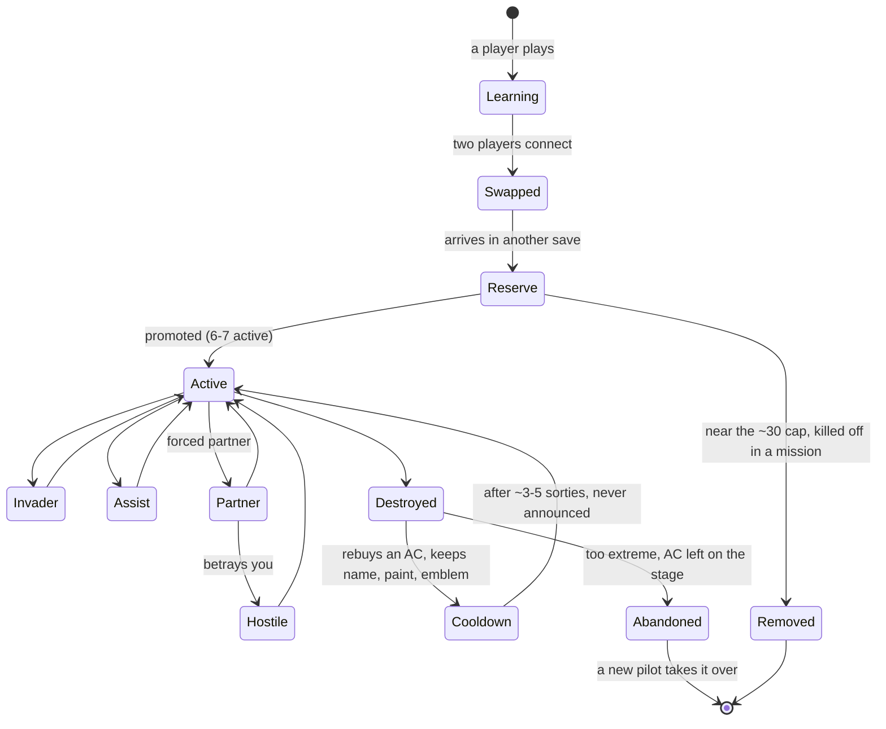
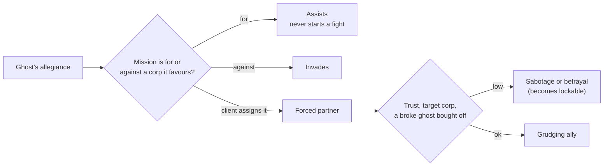

# Ghost rivals and dynamic missions

Design doc, first written 2026-11-14, copied here from the claude.ai design
page so it can be shared and edited in the repo. Nothing here is built yet.
Lines marked **Proposed** are ideas not yet agreed. The campaign side is
summarised with diagrams in [STORY.md](STORY.md).

## Overview

Ghosts are AI pilots that learn from real players and then live on as independent Ravens inside other players' saves. The game never explains or announces them. A dynamic mission builder surrounds an authored story with generated corporate contracts, and gives ghosts places to invade, assist, or be forced into partnership.

- **Hidden by design:** no Ghosts menu, no tutorial, no mail or hints. Players discover ghosts only through what happens in a mission.
- **AI programming becomes trivial:** ghosts learn piloting from their creator over time, so behavior doesn't have to be hand-authored.
- **Status:** design only. Nothing here is implemented yet (the Rogue Arena ghosts in the roadmap are a separate, simpler feature).

## Ghost identity and learning

A ghost takes its piloting skills from its creator and keeps learning them over time. Everything else about it belongs to the save it lives in.

| Part | Source | Notes |
|---|---|---|
| Learned piloting habits | Synced from the creator, ongoing | Preferred range, boost use, weapon swaps, heat handling. Recent play weighted more. Tracked per gen (see below) |
| Name, paint, emblem | Creator, fixed for life | Never change, even after a rebuild. They're the only way to recognize a ghost |
| Frame | Creator's build, fixed | Changes only when the ghost buys a new AC after being destroyed |
| Weapons | Start from the creator's build | Can change through looting |
| Wallet, loot, record | Its own, in the host save | Never flow back to the creator |
| Allegiances | Start from the creator; then its own | Can drift based on what happens in the host save |

The ghost is its own entity: what it earns, loots and experiences in someone else's save stays there. Only skill learning continues to follow the creator.

**Per-gen skills:** a ghost's learned profile has two layers.

- **Shared traits (every gen):** aggression, preferred range, target priority, risk tolerance, when it retreats or extracts.
- **Gen-specific mechanics:** movement, boost and energy habits, and each gen's unique systems (for example, overboost use in Gen 2). Learned only from the creator's play in that gen.
- **Unplayed gen:** if the creator has never played a gen, the ghost flies it using its shared traits plus a default for that gen's mechanics, and starts learning once the creator plays it.

## How ghosts spread and appear

Ghosts reach other saves when players connect, and appear only inside missions, with no warning.

**Spreading:** when two players connect online or over System Link, their current ghosts are swapped automatically in the background. No server is needed. A reconnect refreshes the learned skills only. Ghosts you've met also pass along second-hand in the same swap: only the creator's latest skill profile travels, so each save gets a fresh entity. There is no manual transfer.

**Ways a ghost shows up**

| Role | When | Behavior |
|---|---|---|
| Invader | Missions with an invasion opportunity | Hostile. Allegiance decides which side it joins |
| Assist | Tough fights | Never starts engagements; lets the player lead in every mission |
| Forced partner | Missions where the client assigns a partner | Begrudging ally. Can sabotage or betray (see Allegiance, trust and betrayal) |

**No hints, ever:** no Nest mail or other notice about ghosts' appearances, returns, or anything else. A returning ghost is recognized only by its name, paint and emblem.

**Intro jingles (to explore):** each ghost gets a personal motif, and its arrangement reflects the relationship to the player: ally, mercenary or neutral, rival, nemesis. A forced partner plays its apparent relationship and switches to the hostile version if it betrays you. Sequenced or procedural audio keeps this small enough for Xbox-spec hardware.

## Ghost economy and lifecycle

Ghosts earn, spend and rebuild with their own money, so their strength rises and falls with how they do.

- **Wallet:** earns from invasions, assists and partnerships, and pays for its own repairs.
- **Wingman hire:** a player can request a ghost as a wingman only when affinity with it is already positive. The ghost takes a cut of the reward, priced by affinity.
- **Skimming:** if a player and ghost end up paired with poor affinity, the ghost can steal part of the mission reward. It just shows up as missing credits.
- **Looting:** when it defeats an AC, it has a chance to take that AC's weapons. It keeps only weapons its frame can carry and that fit its learned style, and sells the rest. Frame parts never change from looting.
- **Out of ammo:** a ghost that runs dry mid-mission has a higher chance to pick up a compatible weapon an enemy AC was carrying.
- **Going broke:** a broke ghost flies a bad AC. It can post its own contract asking the player to help it get back on its feet, paying in other ways: per kill, per objective, and so on.

**When a ghost is destroyed**

1. It buys a new AC that fits its learned play style, using its own wallet.
1. It keeps its name, color scheme and emblem.
1. It can't appear again until a cooldown ends. Counted in sorties (around 3–5), longer if the ghost is broke.
1. Its return is never announced.

**Abandoned AC (alternative ending):** if a ghost has become too heavy, extreme or difficult, defeating it in a later mission can leave its AC abandoned. A later mission on the same stage, with a different objective, shows a new pilot taking it over. That pilot might be someone you rescued, or the survivor of an escort that went bad. The new pilot has its own AI; the old learned profile doesn't carry over.

**Roster:** a save holds up to about 30 ghosts, but aims to keep only 6 or 7 present and active in the playthrough. As the total nears 30, ghosts eligible for removal are killed off in missions rather than silently deleted.

- **Active vs reserve:** only the 6–7 active ghosts invade, assist, partner and post contracts. The rest wait in reserve. When an active ghost dies for good, a reserve ghost is promoted into its place.
- **Who's eligible for removal:** reserve ghosts first: second-hand ghosts with the most hops, then ghosts never encountered, then the oldest. A nemesis, ally, current rival or active forced partner is never eligible.
- **How they die:** the builder puts eligible ghosts into missions as targets, invaders or doomed partners, or they're found as wrecks. A ghost removed this way doesn't rebuy; it's gone for good.
- **Fallback:** if the hard cap is hit before an eligible ghost dies, the oldest eligible one is removed quietly.

**Ghosts of players you're close to:** ghosts of people you've played with directly show up later in a playthrough, but are weighted to play a bigger role once they do. They start with a stronger relationship than a second-hand ghost.

| Shared history | Starting relationship | Introduction |
|---|---|---|
| Lots of versus matches | Rivalry | Appears later as a proper threat |
| Lots of co-op | Higher affinity | Arrives as an assist during a dire fight in an offline single-player mission |

After its introduction, the ghost joins the regular pool. Proposed: closeness is measured from direct play history (versus and co-op counts), introductions are held back until a set milestone, Close-player ghosts are less likely to be removed, and if one is, it always happens on-screen within a mission, never through the quiet fallback.

**Arena (proposed):** a ghost earns prestige from wins, earnings and notable kills. Past a threshold, it quietly appears as a ranked opponent in the arena, with no announcement. Between sorties, ghost-versus-ghost arena results are simulated off-screen, so ranks shift on their own. A ghost that goes broke or is destroyed drops out of the arena until it recovers.

## Allegiance, trust and betrayal

A ghost's allegiances start from its creator and then develop on their own in the host save. They decide whether it invades, assists, or turns on you.

- **Corporations:** starts from its creator's history with each corp. Can drift toward corps that keep hiring it in the host save.
- **Pilots and players:** also inherited from its creator, then shaped by what happens in the host save.
- **Which side it takes:** missions for a corp it favors draw assists; missions against that corp draw invasions.

**Trust rules**

- Friendly fire and kill stealing don't count. They just happen in combat.
- **Team kills do count.** Destroying a partner is a major breach of trust.
- A friendly ghost can't be locked onto. When a ghost betrays you, it becomes lockable.

**Forced partnerships:** some missions assign a ghost partner whether either side likes it or not. A begrudging partner can sabotage the mission or betray you outright. Drivers of betrayal: low trust toward you, allegiance to the mission's target corp, and a broke ghost being bought off.

**Support behavior:** an assisting ghost never starts an engagement. The player takes the lead in every mission.

## Mission structure

Authored milestone missions carry the narrative; generated contracts from the mission builder fill the time between them.

- **Milestone missions:** hand-authored story beats and overall progress missions.
- **Contracts:** filler missions made by the builder, offered by several corporations at once.

**How contracts relate to each other**

| Kind | Example | Effect on affinity |
|---|---|---|
| Opposed | Corp A pays you to attack a site that Corp B pays you to defend | Moves affinity with both corps |
| Unrelated | Patrols, salvage, escorts | Small or none |
| Chained | Follow-ups built from save history, such as the abandoned-AC salvage | Depends on the client |

**Board details:** 3–5 contracts at a time, refreshed per sortie, expiring after a few sorties. Opposed contracts are natural invasion spots for ghosts loyal to the other side.

## Affinity

An affinity graphic for the current run only is shown on the mission screen or in the garage (this replaces the earlier no-meter rule). The lifetime total stays hidden. The save screen has a small info box listing missions completed for each corp and client, including small filler contracts, not just the big four. Players also read affinity from two signals:

- **Rival contracts dropping off:** the more you work for one corp, the less often its rivals offer you contracts.
- **Occasional mail updates from corps:** in-character and rare, never a status report. This mail is about corps only; ghosts still never get any.

High affinity also brings better pay, exclusive contracts and part access, while low affinity leads a corp to hire invaders against you.

**Contract affinity points (every contract, prologue included):**

| Contract type | Points |
|---|---|
| Directly against a rival (e.g. a Chrome job that hurts Murakumo) | +2 client, −1 rival |
| Unrelated filler work | +1 client, no penalty |
| Neutral work (city guards, arena, Nest-direct) | +2 Independent |

Negative lifetime values matter: a player who keeps working against a corp produces a ghost that's hostile to that corp, not just loyal to another.

## Dynamic mission builder

Missions are data, and the save keeps a history log. The builder fills mission templates from that history, so past events turn into new contracts.

- **Templates:** stage, client corp, objective (destroy, defend, escort, salvage, intercept, survive), actors and triggers, all in readable files. Imported mission packs can use the same format.
- **History log:** where ghosts fell, who was rescued, which escorts went wrong, and affinity shifts.
- **Example:** a ghost is defeated on a stage, and an escort there goes bad. A later contract on that same stage asks you to deal with the survivor, who is now flying the ghost's abandoned AC.
- **Hooks:** invasions, assists and forced partners plug into any generated mission. Survival and King of the Mountain modes can be templates too.

## Campaign structure

The campaign is not a fixed line: milestones unlock from world-state conditions, and different runs end in different worlds.

- **World state:** tracks which corps and factions are standing, which facilities changed hands, which stages are ruins, and who you've betrayed.
- **Paths:** a 5-mission prologue lets the player define their affinities (missions 1–3 short and simple, mission 4 a 1v1 skill-check fight, mission 5 a little larger; stacking affinity firmly toward one corp makes mission 5 optional, and if played it's a version that builds affinity with that favorite corp). The player's first and second affinity choices show up later in the run as turning-point missions.
- **Endings (current direction):** Chrome rule, Murakumo rule, Nest exposed (independent path only), and mutual collapse (canon's outcome, now just one possibility). Endings differ in who rules, which stages stand and which Ravens survive.
- **Replay:** different affinity means different milestones, stages, ghost loyalties and ending.

**True ending:** completing the Independent / Nest path is the true path forward and leads to Generation 2. The game is structured to push players toward the other three endings (Chrome, Wednesday, Murakumo). On repeat runs, the Wednesday lockout after Sumika's promotion makes the independent ending easier to land. The push comes from scarce, low-paying neutral work early, corps courting harder, and the Nest trap opening only once its conditions are met. The independent route can still be reached on a first run by building affinity in the arena: arena wins count toward Independent affinity, but only sway the endgame if the player reaches the top ranks. Any ending resets that playthrough's affinities but not the arena rank, so the arena route to independence can't be earned a second time the same way. A lifetime affinity tally keeps building in the background across runs: it feeds the player's ghost, whose allegiance becomes more and more set toward one corp, while the player still gets a different path each run. The lifetime tally is capped per corp at −50 to +50, and the ghost's allegiance is read from its share of the tally, with recent runs weighted more, so a ghost becomes firmly set but one long-ago run can't lock it forever.

**Prologue affinity counters (proposed):** tracks for Chrome, Murakumo and Wednesday, each starting at 0.

| Mission | What happens | Points |
|---|---|---|
| 1–3 (short) | Pick one of 2–3 contracts from different clients | +2 to that client, −1 to its direct rival |
| 4 (1v1 skill check) | A client hires you for a duel | +2 to the client, +1 more for winning |
| 5 (larger) | Normally your top two corps bid against each other | +3 to the winner |

- **Stacked toward one corp** (one track at 7+ and all others at 1 or less after mission 4): mission 5 becomes optional, and if played it's the version that builds affinity with that favorite corp.
- **Result:** the highest track sets the first choice, the second-highest sets the second choice; both return later as turning-point missions. The independent path is reached either way: through neutral work (an Independent track fed by neutral contracts such as city guard, arena or Nest-direct work, winning if it's highest) or through close, even affinity (top two corp tracks within 1 point).

## Switching sides

A run offers real chances to upset your allegiance and swap sides.

- **Mid-mission turn:** the target corp makes a counteroffer partway through a contract; accept and turn on your client on the spot.
- **Client betrayal:** your own corp sets you up (ambush, unpaid work, a hired ghost). Surviving it opens a door to the other side.
- **Leverage:** intel found on a mission can be returned to your client or sold to the rival as your way in.
- **Double agent:** quietly take rival contracts while staying loyal on paper. Exposure risk grows each time; exposure is its own milestone.
- **Limited windows:** about 2–3 defection chances per run, tied to world-state turning points.
- **Probation:** the new corp pays less at first and assigns a forced partner to watch you.
- **Fallout:** the old corp cuts you off, hires invaders against you, and its loyal ghosts turn hostile.
- **Kingmaker:** defecting late to the losing side can flip the war and open otherwise unreachable endings.

## Factions (proposed roster)

Each faction has its own arc that advances with the world state, and the arcs cross each other.

| Faction | Role | Arc |
|---|---|---|
| Chrome | Monopoly in power | Tightens control, then desperate measures, or holds on with your help |
| Murakumo Millennium | Parts maker resisting Chrome; Human PLUS | Underdog to exposed experiments |
| Chemical-Dyne Co. | Chrome's partner | Most likely to break away; a lever for switching sides |
| Struggle and armed groups | Corp proxies | Exposing who funds them hurts that corp |
| Wednesday Organization | Research front for Project Phantasma | Turns out to be Doomsday (below) |
| Raven's Nest (Hustler One) | Hidden hand | Leads to the Nest-exposed ending |

City guards appear only as ordinary clients on the contract board, with no system of their own.

## Wednesday / Doomsday arc

The organization first appears under its Japanese-release name, Wednesday Organization, wearing a false image. Its true name, Doomsday, surfaces later without announcement.

1. **The front:** a respectable research foundation with well-paying, clean-looking contracts (escort researchers, guard labs, recover data) and polite mail. It stays out of the corp war.
1. **Cracks:** only in its own contracts: volunteers who never return, cargo you're told not to scan, labs at Amber Crown. Ghosts never disappear as a sign.
1. **The rescue:** a Doomsday mission with a rescue as a secondary objective. The captive is the Sumika stand-in: a friendly ghost with positive affinity and little prior involvement (never a close-player ghost, rival or current partner). The primary objective can succeed without it.
1. **The reveal:** a briefing or mail simply says "Doomsday"; the old name is gone. Stinger appears as enforcer, and past work for them is now on your record.
1. **Phantasma's fate:** destroy it, steal it, hand it to a corp to flip the war, or fail to stop it.

**The Sumika role is always filled; who fills it can change.**

| Rescue outcome | Sumika role | Rescued ghost |
|---|---|---|
| Success | The rescued ghost: ally against Doomsday, then joins the pool with high affinity | Ally |
| Failed or skipped | A second candidate (same rules), arriving differently, e.g. a Wednesday insider who defects with intel. Guaranteed, not a rescue | Returns as Project Phantasma's pilot: same name, corrupted emblem, distorted motif, its own learned skills plus Phantasma's power |

No ghost fits the rules: an authored NPC Raven fills the role. Proposed: defeating the Phantasma pilot is a permanent death.

**What decides Phantasma's fate:** how often you take the Sumika stand-in's missions.

- **Partner with her:** helping her investigation leads you to the Phantasma mission, where you take Phantasma down.
- **Ignore her missions:** Wednesday's timeline keeps moving in the background. It's eventually revealed that Wednesday is the secret Doomsday organization, the Nest steps in and steals Phantasma, and the run heads into the Nest path. The ignored stand-in can be eliminated in the background: a Nest mail reports it, and her Nest rank entry is greyed out (still viewable, no longer interactable). This mail is a deliberate exception to the no-ghost-mail rule.

**Bonus for completing her path:**

- She can wingman for the player in future runs.
- Once you complete the game with her, her AC is promoted from ghost to NPC: her skills are locked where they are at promotion, and she can't betray you. She can still be downed in missions, with the same cooldown penalties as ghosts, but she is never destroyed or deleted.
- The player can buy weapons and equip them on her AC.
- **Repeat runs:** the Wednesday path is locked, so no new Sumika appears. Wednesday works in the background and leads to the Nest ending, unless another ending has already been locked in on that run.

**Chrome vs Wednesday:** Chrome is the corp that puts pressure on Wednesday, posting the contracts that investigate and attack it. It steps in because Wednesday eliminated Chemical-Dyne, Chrome's partner, after their shared resource dispute escalated.

**Reward for destroying Project Phantasma:** the WA-FINGER machine gun.

**Phantasma and the Nest:**

- **The player never owns Phantasma.**
- **The Nest steps in:** when the stand-in's investigation is ignored, the Raven's Nest stops Phantasma's development and steals it, then uses it to build Nine-Ball Seraph. The run routes into the Independent / Nest line, ending at a Phantasma-built Seraph.

## Human PLUS (Murakumo only)

Murakumo's arc is the only path to Human PLUS. Failing the final mission of Murakumo's arc gives the player the same reset as gaining Human PLUS in AC1. Human PLUS becomes a new option part that can be equipped or unequipped, and it takes all available option slots in the core. Enemies and ghosts with PLUS get it for free, without the slot cost, giving them a slight edge.

- **Reaching it:** you must be deep enough in Murakumo's arc (high affinity) to be offered its final mission.
- **Failure is the reward:** fail that mission and Murakumo takes you in, followed by the AC1-style reset with Human PLUS abilities.
- **Proposed:** repeated runs that end the same way could stack further PLUS levels, as AC1's repeated procedures did.
- **Proposed:** a PLUS player's ghost carries PLUS too, so other players can meet PLUS-enhanced ghosts with otherwise-illegal builds.

**Murakumo final mission:** the player, or co-op players, against 3 dedicated units. If played solo, your highest-affinity ghost joins midway for free. Success unlocks picking either of your 2 highest-affinity ghosts as a co-op partner in any mission. All penalties and dynamic-mission rules still apply.

**Ghosts and Human PLUS:** a ghost downed in an attack on Murakumo can return corrupted, with Human PLUS enabled. This is the only way a ghost gains PLUS apart from inheriting it from a PLUS creator.

- **The mark:** a special booster color or trail, used only for PLUS ghosts. Emblem and paint stay original.
- **Previously loyal to Murakumo:** stays composed and loyal to Murakumo.
- **Not loyal to Murakumo:** becomes more erratic and random.
- **Proposed:** it's a chance, not a certainty, and the ghost returns after the normal cooldown with PLUS abilities that allow otherwise-illegal builds.

## Endgame bosses

- **Project Phantasma:** the boss fight is simply a mission offered on the board. Beating it destroys Phantasma (WA-FINGER) and triggers an endgame. If the player ignores the Sumika stand-in's missions instead, the Nest steps in, sends someone else to steal Phantasma, and the run leads into the Nest path with a Phantasma-built Seraph.
- **Nine-Ball Seraph:** beating it is an ending.

**Endgame rewards:** every endgame reward is issued only once and is a permanent unlock. Reward weapons can be sold and repurchased in the shop.

## Chrome arc

Chrome's path is targeted assassinations and shady corporate work. Your repeated success eventually makes you a target yourself.

1. **Proving useful:** assassination and dirty-work contracts. Chrome keeps leaning on you.
1. **Turning point:** once you've over-proven your usefulness, Chrome turns on you.
1. **The hunt:** multiple companies, Chrome included, send their best ACs against you.
1. **The betrayal steal:** during the betrayal you steal something from Chrome. This is a unique, new option part with a decent slot cost, obtained before the final mission so it can be used there. It enables a hangar system like Armored Core 6: four hand weapons, one in each hand and spares held in the back unit slots, freely swapped in place of a back weapon.
1. **Final mission: assault on Chrome HQ.** Place bombs at several locations across the base while paired ACs chase you. Defeating them is optional; they're steady pressure.

- **The chasers:** ghosts due to be cleared from the roster, scaled down in damage, health or skill so the mission is possible but still tough.
- **Final mission reward:** the KARASAWA, plus the unique option part taken during the betrayal.

**Hangar part rules**

- **Swap time:** about one second.
- **Weight:** spare weapons count toward weight.
- **Legality:** the build must still pass the guild's checks. Arena allows it.
- **Ghosts:** ghosts can't use it until the player has unlocked it themselves.

**Hand-held back cannons:** once the player has both the hangar part and Human PLUS, a back cannon can be equipped in the arms.

- **Benefits:** better stability when fired, and the FCS gets better specs while it's held.
- **Costs:** a movement penalty, and it takes both hands, so no blade or left-hand weapon while it's held. The hangar lets you swap back to them.
- **Hidden interaction:** Human PLUS takes every option slot except the one the hangar part uses, so both can be equipped together. The game never explains this; players discover it themselves.

## Mid-run bosses

The sub-corps and factions are mid-run boss fights, and beating one settles you onto an endgame path.

- **Struggle leader:** the mission to defeat Struggle's leader keeps the LS-99 MOONLIGHT as its reward. Proposed: done for Chrome, settles the Chrome path.
- **Chemical-Dyne vs Wednesday:** Chemical-Dyne pushes Wednesday over a shared resource. The dispute grows until Wednesday eliminates Chemical-Dyne, and that's why Chrome, Chemical-Dyne's partner, steps in against Wednesday. Proposed: on the Wednesday path, the player helps eliminate Chemical-Dyne, and its top AC is the mid-run boss that settles the path.
- **Murakumo path pressure:** the Raven's Nest, working with another corp, investigates pilots going missing or being eliminated around Murakumo, which turn out to be Human PLUS experiments. Underneath, the Nest (Hustler One) doesn't use human pilots, so it has no use for PLUS itself. Proposed: it wants PLUS shut down because PLUS pilots can break free of the Nest AI's control. Seraph is not built from the PLUS route. Proposed: the missing pilots are NPC and arena Ravens, not roster ghosts; the mid-run boss is the joint task force's top AC, and defeating it to protect Murakumo's secret settles the Murakumo path. Beating this boss rewards an option part that gives modern controls and hard lock-on (an option part, not a free toggle). Partner corp to be decided.
- **Proposed:** a rampant PLUS Raven, quietly wanted gone by the Nest, settles the independent / Nest path.

## Pilot toggles

Free toggles, set like option parts but with no slot cost, that customize capabilities for every AC the player uses.

- **Auto-purge depleted weapons (opt-in only):** an empty weapon drops automatically, cutting weight and energy drain. There is no other way to purge. The dropped weapon is gone from inventory; at payout, the player chooses to repurchase it at a discount or take the cash.
- **Proposed:** purged weapons stay on the field, so an out-of-ammo ghost can pick them up.

- **Firing groups:** weapons of the same type in different slots fire together, e.g. arm missiles and a back missile share one lock and one fire button. Grouping is meant to be a benefit: lock time is the average of the grouped parts, and the group uses the best FCS and the best range among them.

## Arena economy

The arena used to be easy money. Now it costs money to challenge someone and set up a match.

- **Win:** the prize is still a reward.
- **Lose:** you lose the entry fee. No repair or ammo costs, since arena fights are simulated.
- **Proposed:** fees and prizes scale with the opponent's rank, the prize is always larger than the fee, and ghosts in the arena pay fees from their own wallets.

**Milestone rankers (ranks 1, 10, 20, 30, ...):** milestone enemies with a larger impact. How is still open.

## Open questions

1. Prestige threshold for joining the arena.
1. What turns a ghost "too heavy, extreme or difficult," triggering the abandoned-AC ending instead of a rebuy?
1. Sabotage short of betrayal: what can a forced partner actually do, now that friendly fire and kill stealing don't count?
1. Intro jingles: a motif per ghost, or per relationship type only?
1. Does ignoring a contract change the world (for example, the other side wins that site)?
1. Defection chances: only at designated turning points, or also in generated contracts?
1. Which arena rank counts as "top ranks" for swaying the endgame? What impact do milestone rankers (1, 10, 20, 30, ...) have?
1. Who is the Nest's partner corp in the Murakumo investigation?
1. Hangar option part: exact slot cost.

