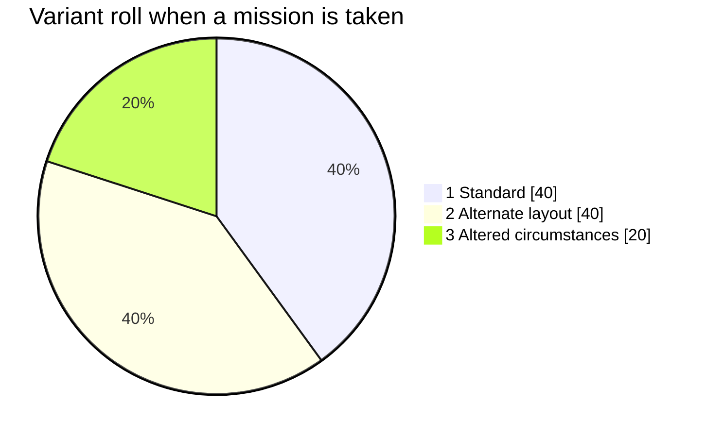
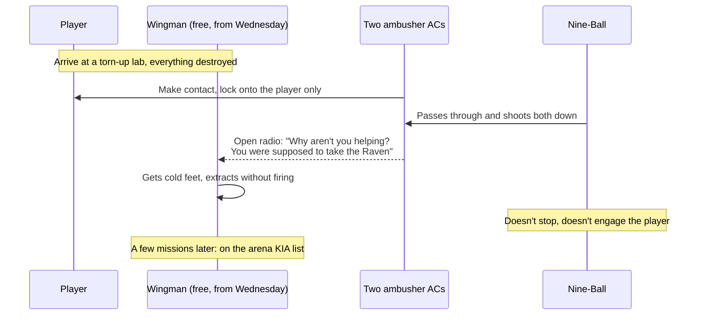
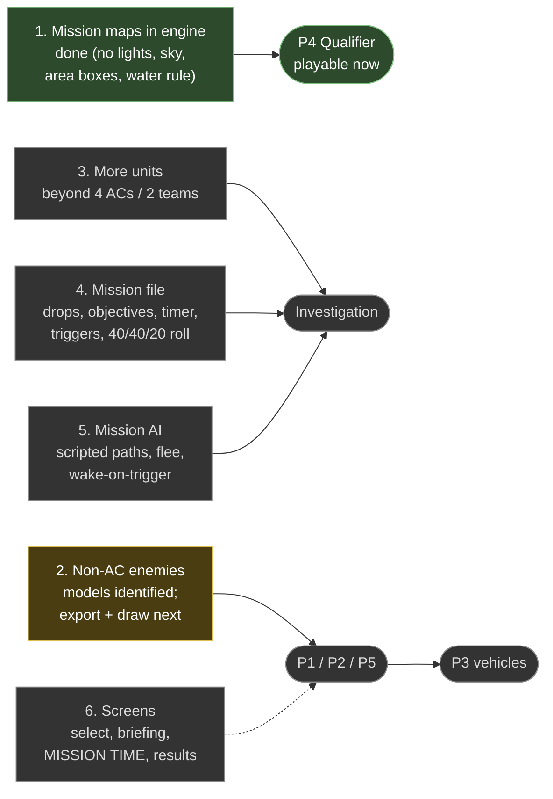

# Missions (Gen 1)

Mission design ideas, the mockup sorties, and what's still missing before
missions run. The story they sit in: [STORY.md](STORY.md). The research
behind the mission maps and units: `docs/research/gen1-stages.md`
("Missions", "Mission units"). Mockup page with maps drawn from the disc
(placements are mock): https://claude.ai/artifact/MSzXcG6wjpGejQjVYjhQ19

## Three variants per mission

Every mission has 3 variants. **The player doesn't pick one: the game rolls
one when the mission is taken.**

1. **Standard:** the mission as first designed.
2. **Alternate layout:** same map and objective; a different drop zone,
   enemies moved, and more of them.
3. **Altered circumstances:** adds a player, ghost or enemy AC; the
   objective runs past the original mission; the first half is easier than
   Standard and the end brings a surprise.

**Briefings** only ever describe variant 1 or 2. Variant 3 is never
briefed: it's a situation that happened, or is still going on, during
deployment, so the player meets it in the mission. (Assumed: a variant-3
roll shows the Standard briefing, and the mockups' variant-3 briefings
become in-mission radio.)

Mockup convention for an invader slot: a live player via URGENT MISSION
REQUEST first, then a ghost, then an authored AC.

## Mockup sorties

| # | Title | Client | Stage | Alternate | Altered (added AC → extension) |
|---|---|---|---|---|---|
| P1 | Clear the block | Chrome | 4 city block | North drop, squatters dug in south, + turret, +2 MT | Invader hired by squatters → protect survey team |
| P2 | Field test | Murakumo | 7 walled compound | West drop, units moved, +2 turrets, +2 MT, +2 heli | Murakumo observer ghost; turrets offline → hold uplink vs Chrome AC + 2 MT |
| P3 | Safe passage | Wednesday | 15 highway | Drop ahead of the transport, tank roadblock, +2 heli, +1 MT | Invader (Chrome request, briefing says cargo is weapons) → hold transfer, escort two vehicles |
| P4 | Qualifier | Raven's Nest | 11 four-pillar hall | Corner start, examiner behind cover, +2 drone MTs | Light examiner; challenger (versus rival / rival ghost) enters at half AP |
| P5 | Deep works | Highest-affinity corp | 0 rooms + tunnels | East entry, generators moved, guard AC on the exit route, +3 MT, +2 turrets | Co-op partner; 2 gens pre-sabotaged → plant core → rival-corp AC cuts off the entry |
| 6 | Investigation | Wednesday | 8 lab, winding tunnels | East entry, 3rd ambusher not in Nine-Ball's path | Ghost wingman; recover data core → Wednesday clean-up AC at the exit |

Rewards and mission times are on the mockup page. Open: is Hearth 2 from P3
the Wednesday transport in Investigation?

## "Investigation": the Wednesday trap

**Setup.** Wednesday (Doomsday under its false, benign image) hires the
player to find Doomsday and where it's hiding. Really it's hunting itself:
the job is a trap for a Raven who has become a problem. Nine-Ball is
already at the site, making a mess of things for his own reasons.

**The wingman.** Wednesday adds a wingman to the contract for free ("for
your safety"). He's part of the ambush. Wingmen normally cost money, so the
free one is a quiet tell.

1. The site is a lab, torn up, with everything destroyed.
2. Two enemy ACs make contact. They lock onto the player only and never
   target the wingman.
3. As the fight starts, Nine-Ball passes through and shoots both down.
   They're hostile and in his path, so by his rules they're threats.
4. Before they die, the ambushers call out to the wingman over open radio.
5. The wingman gets cold feet and extracts mid-fight without firing a
   shot. That's how he survives, and it makes him an enemy of Wednesday.
6. A few missions later he appears on the arena's KIA list: Wednesday dealt
   with him off-screen.

**Cover stories (no two match).**
- **Wednesday's mail (straight after):** ties things up with a story that
  doesn't match the Nest's but still portrays Nine-Ball as helpful; says
  the wingman "withdrew due to damage".
- **The Nest's mail (later):** a round-up of several events. It gives a
  rescue excuse for the lab, though the player saw no one held there, and
  confirms that a shadow organization exists.
- **Arriving with the Nest's mail:** an urgent mission request from
  Wednesday.

**Hidden clues.** Details go missing if the player isn't paying attention.
Clues are never highlighted, repeated or summarised: no codex, no "new
info" marker.

**Open questions.**
- Does a Wednesday transport pick up the fleeing wingman, or does he run on
  his own and get hunted down off-screen?
- What is Wednesday's urgent request? (A clean-up dressed as defence;
  turning the player on someone who knows the truth; a loyalty test.)
- What does Nine-Ball do if the player fires on him? (A warning first, a
  fight straight away, or he just leaves.)

## What MoA's mission data holds

- FDAT stages 0-19 are Master of Arena's mission maps (20-40 are the
  arenas). Every stage is built from reusable tiles on a 2,500-unit grid.
- Mission n is played on map n. `GG/MS/MIS.T` holds only the briefings
  (sender, requester, reward, text pages, briefing maps).
- Mission code: FDAT 5s+0. Header slot 0 is per-frame mission logic (radio
  lines); slots 9+ are object handlers. Chunk 13 holds the mission objects.
- Each map carries its own unit models: 43 different units across maps
  0-19 (MTs, helicopters, jets, drones, tanks, turrets, bunkers, enemy ACs).
- Tools: `tools/research/moa_missions.py`, `tools/research/moa_units.py`.

## Progress toward playable missions

Test order: P4 (now, a 1v1 vs CPU on map 11 in AC TEST) → Investigation
(after 3-5) → P1 / P2 / P5 (after 2) → P3 (vehicles). Screens can be
skipped in tests with a direct launcher.
