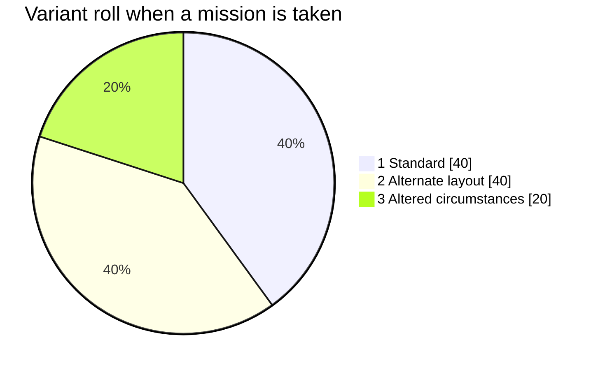
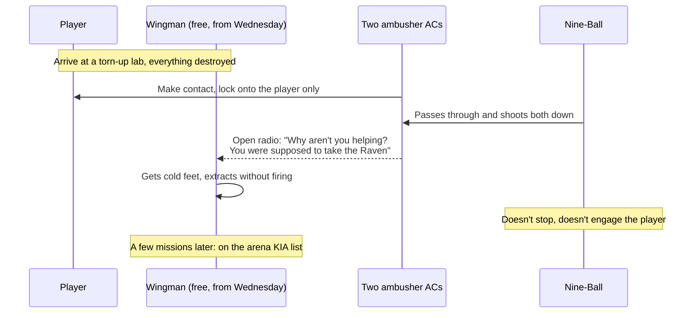
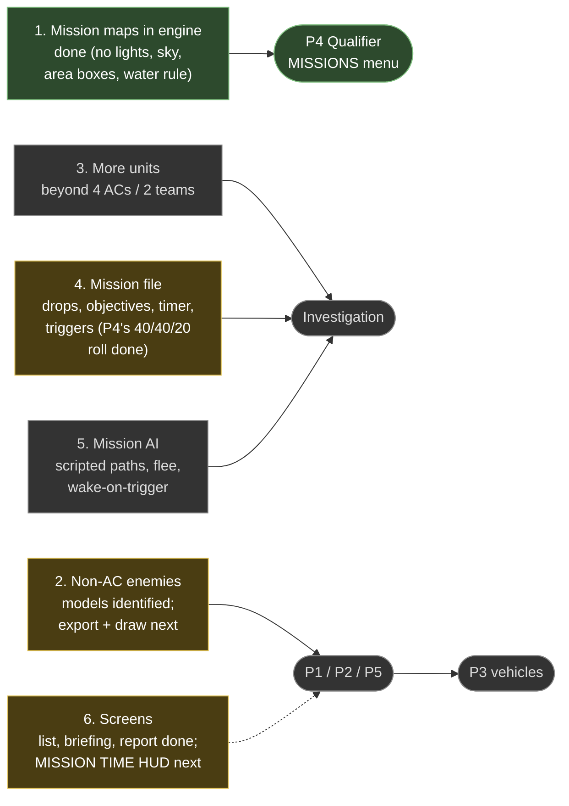
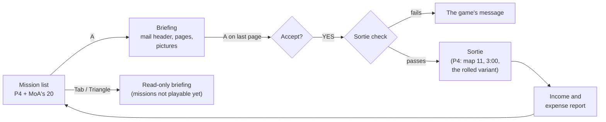

# Missions (Gen 1)

Mission design ideas, the mockup sorties, and what's still missing before
missions run. The story they sit in: [STORY.md](STORY.md). The research
behind the mission maps and units: `docs/research/gen1-stages.md`
("Missions", "Mission units"). Mockup page with maps drawn from the disc
(placements are mock): https://claude.ai/artifact/MSzXcG6wjpGejQjVYjhQ19

## Three variants per mission

Every mission has 3 variants. **The player doesn't pick one: the game rolls
one when the mission is taken.**

1. **Standard:** the mission as first designed.
2. **Alternate layout:** same map and objective; a different drop zone,
   enemies moved, and more of them.
3. **Altered circumstances:** adds a player, ghost or enemy AC; the
   objective runs past the original mission; the first half is easier than
   Standard and the end brings a surprise.

**Briefings** only ever describe variant 1 or 2. Variant 3 is never
briefed: it's a situation that happened, or is still going on, during
deployment, so the player meets it in the mission. (Assumed: a variant-3
roll shows the Standard briefing, and the mockups' variant-3 briefings
become in-mission radio.)

Mockup convention for an invader slot: a live player via URGENT MISSION
REQUEST first, then a ghost, then an authored AC.

## Mockup sorties

| # | Title | Client | Stage | Alternate | Altered (added AC → extension) |
|---|---|---|---|---|---|
| P1 | Clear the block | Chrome | 4 city block | North drop, squatters dug in south, + turret, +2 MT | Invader hired by squatters → protect survey team |
| P2 | Field test | Murakumo | 7 walled compound | West drop, units moved, +2 turrets, +2 MT, +2 heli | Murakumo observer ghost; turrets offline → hold uplink vs Chrome AC + 2 MT |
| P3 | Safe passage | Wednesday | 15 highway | Drop ahead of the transport, tank roadblock, +2 heli, +1 MT | Invader (Chrome request, briefing says cargo is weapons) → hold transfer, escort two vehicles |
| P4 | Qualifier | Raven's Nest | 11 four-pillar hall | Corner start, examiner behind cover, +2 drone MTs | Light examiner; challenger (versus rival / rival ghost) enters at half AP |
| P5 | Deep works | Highest-affinity corp | 0 rooms + tunnels | East entry, generators moved, guard AC on the exit route, +3 MT, +2 turrets | Co-op partner; 2 gens pre-sabotaged → plant core → rival-corp AC cuts off the entry |
| 6 | Investigation | Wednesday | 8 lab, winding tunnels | East entry, 3rd ambusher not in Nine-Ball's path | Ghost wingman; recover data core → Wednesday clean-up AC at the exit |

Rewards and mission times are on the mockup page. Open: is Hearth 2 from P3
the Wednesday transport in Investigation?

## "Investigation": the Wednesday trap

**Setup.** Wednesday (Doomsday under its false, benign image) hires the
player to find Doomsday and where it's hiding. Really it's hunting itself:
the job is a trap for a Raven who has become a problem. Nine-Ball is
already at the site, making a mess of things for his own reasons.

**The wingman.** Wednesday adds a wingman to the contract for free ("for
your safety"). He's part of the ambush. Wingmen normally cost money, so the
free one is a quiet tell.

1. The site is a lab, torn up, with everything destroyed.
2. Two enemy ACs make contact. They lock onto the player only and never
   target the wingman.
3. As the fight starts, Nine-Ball passes through and shoots both down.
   They're hostile and in his path, so by his rules they're threats.
4. Before they die, the ambushers call out to the wingman over open radio.
5. The wingman gets cold feet and extracts mid-fight without firing a
   shot. That's how he survives, and it makes him an enemy of Wednesday.
6. A few missions later he appears on the arena's KIA list: Wednesday dealt
   with him off-screen.

**Cover stories (no two match).**
- **Wednesday's mail (straight after):** ties things up with a story that
  doesn't match the Nest's but still portrays Nine-Ball as helpful; says
  the wingman "withdrew due to damage".
- **The Nest's mail (later):** a round-up of several events. It gives a
  rescue excuse for the lab, though the player saw no one held there, and
  confirms that a shadow organization exists.
- **Arriving with the Nest's mail:** an urgent mission request from
  Wednesday.

**Hidden clues.** Details go missing if the player isn't paying attention.
Clues are never highlighted, repeated or summarised: no codex, no "new
info" marker.

**Open questions.**
- Does a Wednesday transport pick up the fleeing wingman, or does he run on
  his own and get hunted down off-screen?
- What is Wednesday's urgent request? (A clean-up dressed as defence;
  turning the player on someone who knows the truth; a loyalty test.)
- What does Nine-Ball do if the player fires on him? (A warning first, a
  fight straight away, or he just leaves.)

## What MoA's mission data holds

- FDAT stages 0-19 are Master of Arena's mission maps (20-40 are the
  arenas). Every stage is built from reusable tiles on a 2,500-unit grid.
- Mission n is played on map n. `GG/MS/MIS.T` holds only the briefings
  (sender, requester, reward, text pages, briefing maps).
- Mission code: FDAT 5s+0. Header slot 0 is per-frame mission logic (radio
  lines); slots 9+ are object handlers. Chunk 13 holds the mission objects.
- Each map carries its own unit models: 43 different units across maps
  0-19 (MTs, helicopters, jets, drones, tanks, turrets, bunkers, enemy ACs).
- Tools: `tools/research/moa_missions.py`, `tools/research/moa_units.py`.

## Progress toward playable missions

Test order: P4 (now, from the MISSIONS menu; also still in AC TEST on map
11) → Investigation (after 3-5) → P1 / P2 / P5 (after 2) → P3 (vehicles).
Screens can be skipped in tests with a direct launcher.

## MISSIONS screens (2026-11-25)

Main menu > MISSIONS. Code: `src/platform/sdl3/missions.c` (screens),
`src/gen1/acr_gen1_missions.c` (rules, unit tests in
`tests/test_gen1_missions.c`), `tools/acr_import/acr_missions_moa.c`
(what acr-import reads from the disc).

**What's on the screens and where it comes from**

| What | Source |
|---|---|
| MoA's 20 missions: name, requester, sender, reward, briefing pages, pictures | Your disc, through acr-import: `GG/MS/MIS.T` entry 0 (the menu's mission table) and the page / picture entries it points to. Written to `<import>/missions/` |
| Page markup: `@1 ... @0` yellow words, `%n` picture n | The disc's own markup in the pages; the pictures match (e.g. Eliminate Fugitive's `%0` is the Armored Car) |
| P4 Qualifier: Raven's Nest, 10,000 C, 3:00, briefing | The user's mockup (Standard variant); its last page follows MoA's "Theater of operations" page with the mockup's facts |
| P4's examiner AC | The user's AI Battle card ([missions/p4-examiner-card.png](missions/p4-examiner-card.png), format 4): XCA-00, HD-REDEYE, AN-201, LN-1001, WG-MGA1, LS-200G, WC-CN35 + WM-X201, COMDEX-G0, GBG-10000, B-HP25; no options, no Human PLUS, BALANCED AI; the card's paint. Names (user): AC **Anfang**, pilot **NEST EXAMINER** |
| Sortie check and its three messages | MoA's menu 0x800967C4: incomplete (a part, or a booster on legs that need one) → weight (legs or arm load) → energy. Option slots aren't checked |
| Income and expense report: picture, digits, row positions, timing | RTIM 63 / 64 (success, picked at random) and 65 (failure), drawn by the missions engine 0x800918E8 |
| Report maths | See below |
| Mission record | Saved in the garage's save file, section `[missions]` |

**The report (MoA's rules, read from the disc 2026-11-25).**

- **Reward**: the mission's reward on a success, 0 on a failure.
- **Special addition / Special deduction**: tallies a MoA mission's own
  code and breakable structures keep. P4 pays its Altered circumstances
  bonus (12,000 C for beating the challenger) as the special addition;
  otherwise they are 0.
- **Ammunition**: for each solid weapon (damage flag 0x10), rounds fired
  × its ammo price. Energy weapons cost nothing.
- **A.C. repair**: (AP max − AP left) × (AC price ÷ 100) ÷ 8,000, rounded
  down. The AC price is every fitted part but the options. The menu adds
  it up at launch, and a two-slot back unit counts twice, as on the disc.
- **Balance** is the sum. **Total credits** = credits + balance, kept
  between −999,999 and 9,999,999.

A failure still pays ammunition and repair. Mission progress and credits
go into the same save as the garage.

## P4's three variants (2026-11-25)

The game rolls P4's variant when the MISSIONS screen opens (40 % Standard,
40 % Alternate layout, 20 % Altered circumstances) and keeps it until P4
is flown; the next visit rolls again. The list, the briefing and the
sortie all use the rolled one. Variant 3 is never briefed: its briefing
reads as Standard's, and the mockup's variant-3 briefing comes as radio
during the fight. Code: `acr_gen1_mission_roll` / `acr_gen1_mission_variant`
(`src/gen1/acr_gen1_missions.c`), the rules in `src/gen1/acr_gen1_mission.c`
(`acr_gen1_mission_start_own`), tests in `tests/test_gen1_missions.c`.

| | Standard | Alternate layout | Altered circumstances |
|---|---|---|---|
| Reward | 10,000 C | 12,000 C | 10,000 C + 12,000 C special addition for beating the challenger |
| Time | 3:00 | 3:00 | 3:00, + 2:00 when the challenger comes (the mockup's 5:00) |
| Briefing | Standard's | its own (mockup) | Standard's |
| Starts (map 11) | as before, facing down the middle | you in the south-west corner, the examiner behind the north-east pillar | as Standard |
| Enemies | examiner (Anfang) | examiner + 2 drone MTs in the north corners (optional: only the examiner counts) | examiner; below half AP it withdraws and the challenger drops in on the east side |
| Won by | examiner down, or more AP at time up | the same; the drones never count | the challenger down, or more AP than whoever is there at time up |

**Where each piece comes from**

| What | Source |
|---|---|
| Rewards, times, briefing text, layout, "only the examiner counts", challenger below half AP, "Continue the test." | The user's mission mockups (2026-11-20) |
| Drone MTs | Master of Arena's small drone, unit U10, as map 13 has it (records 11-14: AP 950, attack 50; it has 4 animations, so it fights as a turret that turns and fires). The user picked it (2026-11-25). Borrowed from map 13 by `demo_units_borrow` |
| The examiner in variant 3 | The same Anfang (the user: "use the same examiner I provided before"), not a light build |
| The challenger | A MoA arena Raven while versus rivals and ghosts don't exist (the user, 2026-11-25): **The Wolf** (pilot Prime, main arena rank 14, no Human PLUS), its own build, paint and AI from your disc's arena table |
| Radio text | Variant 3 only: "NEST: A shortened test today. Win, and you're through." (the mockup's briefing less the light build) and "NEST: Continue the test." Text on screen for 5 seconds; no voice |

**Choices made here (tell me if you want them different)**
- Places on map 11 are the mockup's marks moved a little: the hall is
  about ±11,800 across the mockup's picture and the pillars stand at
  ±5,700, so the examiner sits at (7,400, 7,400), clear of the pillar, and
  the drones go deeper into the corners (±9,300, 9,600) so they don't
  overlap it. The drones' guns reach 7,000, so they only fire once you
  come north.
- Variant 3's clock starts at the briefed 3:00 and the challenger adds
  2:00, so the briefing stays true and the whole test is the mockup's 5:00.
- The challenger falls in from 2,500 above (8,000, 0) facing west. The
  examiner just leaves the hall when it comes (there's no exit to walk to).
- A draw (both down, or equal AP at time up) is a failed mission, as for
  the Standard variant.

**Testing aids**: `ACR_MISSION_VARIANT=1|2|3` picks P4's variant instead
of rolling; `ACR_MISSION_FOE_HURT=1` starts the opponent just below half
its AP (variant 3: the challenger comes at once).

**Not yet** (P4): its radio has no voice.

## The discs' missions (2026-11-27)

Every mission on your two discs can now be flown from MAIN MENU >
MISSIONS: **Master of Arena's 20** (MOA-00 to MOA-19) and **Project
Phantasma's 17** (PP-00 to PP-16, listed after them once its disc is
imported). Re-import (or just start the game: the import refreshes itself)
to get Phantasma's maps, units and briefings.

How a disc mission flies: your garage AC alone on the mission's own map,
dropped at the map's record 0, against the map's units (MTs, turrets,
aircraft, enemy ACs). The map's own rules decide it; when they're done, the
usual income and expense report follows (reward, ammunition, repair).

| Missions | Rules | State |
| --- | --- | --- |
| MoA 2, 6, 12, 13, 15 | the game's, read before (2026-11-24/25) | as before |
| MoA 1, 3, 4, 5, 7, 8, 10, 11, 14, 17, 19 | the game's own script, read 2026-11-27: objectives, fails, clocks (3: 5:00, 14: 3:00), late arrivals, waves | radio and cutscenes left out |
| MoA 0, 9, 16, 18 | partly the game's; where its trigger is a stage gimmick (a door, switch, container) a stand-in, see below | playable, check the feel |
| Phantasma 0-16 | stand-in for all: everything down -> the units the map holds back come in -> everything down wins | scripts not read yet |

**Stand-ins (tell me if any feels wrong):**
- MOA-00 Eliminate Fugitive: won when the Armored Car is destroyed (the game
  ends on a door near it; "permission to take him out" in the briefing).
- MOA-01 Defend Submarine: falling into the sea fails it, as in the game;
  the submarine itself can't be sunk yet (the engine has no breakable
  structures), and the ships don't move.
- MOA-03 Destroy Cannon: the jet and the AC come once four drones are down.
- MOA-09 Recover material: after the tank-legged AC is down, get within
  1,000 of the container.
- MOA-16: when everything's down the next group comes, then the AC.
- MOA-18 Factory core: the switch is bumped by walking into it; the core
  is a lift, and bumping it (or the blade) turns it, which wins, as the
  game. Lifts on maps 1, 5, 7, 9, 16, 18 and 19 run, with their call
  buttons; standing on one carries you.

**Unlocks (user, 2026-11-27):** every mission stays unlocked in the
MISSIONS menu until play-testing shows they all work; the proper unlock
structure (chapters) comes after.

**Original content stays as on the disc (user, 2026-11-27):** disc
missions get no variants and no added content; variants and extras are for
our own custom campaign only. The stand-ins below are temporary.

**Known gaps:** no radio voices or text, no cutscenes, MoA's mail. Some Phantasma drops may sit
inside a wall (PP-11 looked wrong in a headless check). Split screen co-op
on a disc mission still runs with an opponent slot that is put out of the
fight; not checked.

**Testing aids:** `ACR_MISSION=MOA-05` (or `PP-03`, `P4`) skips the
screens and flies that mission at once; `ACR_UNITS_DOWN=1` starts with
the units in the fight destroyed (the map's next step comes).

Project Phantasma's maps are stages 50-66 (`ACR_STAGE=50` opens one in AC
TEST). AC1's missions use the same briefing table but a different file
layout; not imported yet (docs/research/gen1-stages.md, "Armored Core (AC1)
missions").
