# Roadmap (agreed 2026-11-14)

Where the Gen 1 (Master of Arena) game goes next, in order, with the
decisions behind it. Earlier work: movement, fitting rules, lock-on,
weapons, damage, two-player test build (see `docs/research/`).

## At a glance (2026-11-23)

Green = a first version is in; yellow = started; grey = not started. Each
box's details are in the numbered steps below.

```mermaid
flowchart LR
    subgraph Foundation
        R0["0 Renderer"]:::done
        R1["1 Model formats"]:::done
        R2["2 Model import"]:::done
    end
    subgraph Play
        R3["3 Garage, shop,<br/>AC TEST"]:::done
        R5["5 Battle HUD"]:::done
        RA["Rogue Arena 19+1"]:::done
        MC["Modern controls"]:::done
    end
    subgraph Online
        R6["6 Netplay<br/>rollback 1v1 + co-op"]:::done
        CO["Rogue Arena co-op<br/>local 2P + online"]:::doing
    end
    subgraph Content
        R4["4 / 7 Arena<br/>2 stages, walls"]:::doing
        MS["Missions<br/>P4 from MISSIONS menu"]:::doing
        TM["Tinkercad maps"]:::doing
        ST["Campaign / story"]:::todo
    end
    subgraph Platforms
        R8["8 UI<br/>main menu in"]:::doing
        R9["9 Android<br/>first APK"]:::doing
    end

    Foundation --> Play --> Online --> Content --> Platforms
    R6 --> CO
    MS --> ST

    classDef done fill:#2d4a2d,stroke:#7fbf7f,color:#fff
    classDef doing fill:#4a3d12,stroke:#e0c050,color:#fff
    classDef todo fill:#333,stroke:#888,color:#ddd
```

Design docs for what comes after: [STORY.md](STORY.md) (campaign),
[GHOSTS.md](GHOSTS.md) (ghost rivals, contracts, affinity),
[MISSIONS.md](MISSIONS.md), [ROGUE-ARENA-COOP.md](ROGUE-ARENA-COOP.md).

## Decisions

- **Model files**: `acr-import` writes each part as **OBJ + PNG textures +
  a small rig file** (readable, like the part files). AC1 parts are rigid
  pieces on joints, so OBJ fits; animations stay in our own text files. The
  engine keeps a compact cached copy for speed and the Xbox memory budget.
- **Garage**: starts from Master of Arena's layout; restructuring (less
  scrolling) comes later.
- **Shop economy**: the same as Master of Arena (prices, selling), so builds
  can be tried freely.
- **Step rate**: 60 steps a second is the target. The game's movement rules
  run at its own 22 ticks a second between steps, exactly as on the PS1, and
  the AC is drawn sliding from one tick to the next, so every step rate plays
  at the game's pace (changed 2026-11-18: before, boosting, rising and
  falling moved a whole Gen 1 tick's distance every step, 2.7 times the
  game's speed at 60). Shots and lock times also count Gen 1 ticks.

## Order

0. **Renderer** (first version done): OpenGL 2.1 fixed function, loaded at
   run time; lighting done on the CPU like the PS1 (ambient + up to 3
   directional lights, per face or vertex) plus distance fog, so every
   platform shows the same picture. Native resolution and any screen shape;
   the HUD sits on a 480-high grid whose width follows the screen. The
   engine core also builds for the original Xbox (nxdk) in the automatic
   builds. Still to come: paletted textures and a per-platform cook step,
   and settings for render scale, anti-aliasing, texture filtering and an
   authentic (low resolution) mode.
1. **Model formats** (research): trace in the recomp which files the game
   loads for an AC and how it draws them; decode mesh, texture and skeleton
   formats. The animation records already read for root motion also hold
   joint rotations.
2. **Model import and display** (first version done): OBJ/PNG/rig export
   per part; the engine (`src/model/`) reads the export, puts the build's
   parts on its animation set's skeleton, plays the joint animations with
   their hold times and builds the patterned textures from the player's
   colours. The test build draws both ACs this way. Still to come: drawing the
   "fx" faces with the effects page (found: RTIM 61, docs/research/gen1-effects.md), per-texel semi-transparency, aiming joints
   (tables a/b), kneel/landing poses and colour patterns 1-15.
3. **Garage, shop, test mode** (first version done): the game opens on the
   main menu (step 8). `src/gen1/acr_gen1_garage.c` (no OS calls) holds what a player
   owns, credits, buying and selling (full price back; no trading while in
   debt, as in the PS1 games), fitting under the game's rules (a part the
   build rules out is refused; parts the new one can't be used with come
   off) and a readable, versioned save file. The PC build shows MoA's slot
   order (HEAD ... ARM WEAPON R), the parts you own per slot, the shop by
   category with buy/sell, the build's totals and the VS START check, with
   the real AC turning in the middle. AC TEST is the test arena with that
   build; Esc / Back+Start returns. **Test builds** (`k_test_kit` in the PC
   main): a new save owns one of every part and the shop starts empty; parts
   sold to it stay in its stock and can be bought back, so any part can be
   tried while the game's feel is restored. A release turns this off: the
   starting AC, the shop's real stock and starting credits scaled for it
   (Project Phantasma started at 0; `--credits N` sets it for now).
   Still to come: the shop's real stock (hidden and prize parts), part
   preview while choosing, paint (EDIT COLOR,
   the 15 patterns), AC/pilot names, player 2's garage, MoA's part
   parameter pages.
4. **Arena**: stages from the disc (same mesh decoder), then collision
   (walls, floors, heights), then rankings, opponents and rewards.
   Started 2026-11-19 (`research/gen1-stages.md`): every stage's areas,
   flat models and collision import; Green Silo plays in AC TEST.
   The game's own wall and floor rules are in (2026-11-19, branch
   `gen1-arena-walls`): one box pushed out of the nearest polygon, sliding
   along walls, following slopes, falling off edges; Ocean Platform (the
   user's pick for the second arena) joins Green Silo in AC TEST (F7).
   Out-of-area: the rule is in (warning, then the loss) with a test
   boundary (F8); the stages' own boxes aren't found yet. Next: those
   boxes, the other stages, stage lights (all three done by 2026-11-25).
   Mission maps (2026-11-20, branch `gen1-mission-stages`): acr-import
   writes stages 0-19 too; AC TEST's F7 adds mission map 11 (the P4
   Qualifier hall) and `ACR_STAGE=NN` opens any of 0-40 (`ACR_STAGE=open`:
   the open floor). Maps 1 and 6 are sea maps: their ground is the water,
   so AC TEST starts them on a ship deck and the platform.

5. **Battle HUD** (first version, branch `gen1-hud`, 2026-11-19): the
   game's own HUD pictures (RTIM 61, exported to `<import>/hud`) placed as
   in Master of Arena (`docs/research/gen1-hud.md`): AP, energy gauge,
   enemy AP, compass, radar, weapons by type, warning boxes, the AC's
   name, WIN / LOSE / DRAW / TIME UP. 4:3 framing by default; F9 or
   `--hud-wide` spreads it to a wide screen's edges. Test readouts moved
   under F1. Needs a re-import. Still to come: the HUD code's exact
   positions, the split-screen layout, READY / GO, REC once replays exist.

## Rogue Arena (branch `gen1-rogue-arena`, 2026-11-19)

Brought over from the AC1Recomp fork's Rogue Arena (release 0.8.4.4.2) at
its rules, with **19 opponents + the player** instead of 49 + 1, and no
balance changes (user). Main menu -> ROGUE ARENA. Needs a re-import:
acr-import now writes the game's arena opponents to `<import>/arena/`
(158 on the USA disc: build, colours, names, prize, and the AI editor's
rows read back from each opponent's 36-byte AI record).

- Rules: `src/gen1/acr_gen1_rogue.{h,c}` (no OS calls; tests in
  `tests/test_gen1_rogue.c`). One seed makes the run: the ladder (the
  game's own opponents on AC1Recomp's difficulty curve; Nine-Ball sits
  out; KARASAWA users kept to the top 10, Human PLUS users to the top 8,
  scaled from 25 / 20 of 49) and a random legal starting AC with a real gun,
  at 0 P.
- Each win +1 P; then the prize screen: cheap / mid / expensive offers (P
  by where a part's price sits: 1-7), the specials (HUMAN PLUS 13 P,
  ALL OPTIONS 15 P, +1 P PER WIN 6 P, ARMS SET 7 P on weapon arms), PASS
  +1 P, RE-ROLL 1 P once a win. EQUIP NOW (what it replaces is gone for
  good) or SAVE FOR LATER (SWAP PARTS at the hub). AC1Recomp's offer rules
  are kept (one leg type a screen, no radars or P77-ST, fewer crouch
  cannons on two legs).
- Hub: NEXT BATTLE (the VS screen, below), SWAP PARTS, STAGE
  (Green Silo, Ocean Platform, Garden Plaza, Night City: the user's four
  for now), GARAGE (assembly only), QUIT; the ladder beside it; the
  background is the belt tile of the player's rank (AC1Recomp's tiles).
- Fights: no time limit since 2026-11-25 (was two minutes; user), the
  opponent flown by our Gen 1 brain with its own AI rows and Human PLUS
  level, in its own colours. Esc twice gives up (a
  loss). A draw counts as a loss.
- One loss: RETRY ARENA (same ladder, new random AC at 0 P; the losing AC,
  prize parts and all, stays as a ghost at the rank it held, with the AI of
  the opponent it pushed down), NEW ARENA, QUIT. Beaten ghosts are saved to
  `rogue-ghosts/`. Rank 1 clears the arena.
- Files beside the save: `rogue-run.toml`, `rogue-garage.toml`.
  `ACR_ROGUE_SEED=...` starts new arenas from that seed (testing).
- Brought over next (2026-11-19, matching 0.8.4.4.2): **PART SPECS**
  (Triangle / Tab on a prize or a saved part: the part fitted now beside
  the new one, the same stat rows, new values green / red with the
  difference, the shop's text from the disc (MIS.T 385), the AC's weight,
  legs load and energy before > after; upgrades and sets get one window
  saying what they do; up / down: the next one). The **VS screen**
  (fighting-game style: both ACs in 3D, the opponent's emblem behind it,
  FOR RANK, the count, the strip of the last three beaten (crossed out on
  counts 3, 2, 1 with the game's rifle shot), YOU, the next and the rest
  of its belt; hangar shutters, black, fight; Enter skips the count). The
  **victory screen** (the beaten AC on its back, smoking; the winner
  sliding in; YOU WIN with a flash on the sting's big chord; two lines by
  belt typed a word at a time). **Sounds**: the menu bank's clicks on
  every Rogue Arena screen (cursor, OK, back, the garage's equip sound),
  AC1Recomp's made victory sting and type tick and the reshaped VS shots
  and shutter slam, all with its shared 90s finish
  (`src/platform/sdl3/rogue_sound.c`). acr-import now also writes
  `sfx/menu-*.wav` and each opponent's `arena/.../<RR>-emblem.tim`; an
  older import gets them at start-up from its `unpacked/` folder
  (`acr_import_refresh`), no re-import needed.
- Differences from AC1Recomp: the strip's belts are two ranks on a ladder
  of 19, so it shows the last three beaten whatever their belt; PART
  SPECS has no part pictures yet; ghosts have no emblem.
  `ACR_ROGUE_AUTOWIN=1` counts every fight as won (screen tests).
- Not brought over: the shop (0.8.4.4.2 removed it too: parts come from
  the prize screen). Option parts are owned and fitted, but the fight
  doesn't use options yet (true of the whole engine).

Fixes after the first play-test (2026-11-19):
- **Four-legged and caterpillar legs move** (they stood still): their
  walking animations carry no root motion; the game's second movement
  handler (VS `0x80085704`) pushes them like the ground boost, by player
  block +0x208 a tick up to +0x20A (the legs' fixed boost bytes), along the
  facing turned by the stick (0, 45, 90, 135, 180 degrees); with no
  direction the speed is cut to the top and slows by a quarter of +0x208
  (as the air does, `0x80014790`, not measured on these legs). No energy
  while walking; the booster is the ground boost as before.
- **Caterpillars** (user): no jump and no ground boost. The booster lifts
  them straight into the rising boost, from a stand or on the move, without
  the take-off kick the other legs start their arc with.
- **Empty weapons** (user): no automatic swap; an empty weapon stays
  selected until the pilot switches away, then can't be picked again. With
  one weapon, or the last one empty, the pilot is stuck with it.
- **CONTROLS page** (SYSTEM > SETTINGS, user): remap the controller's boost,
  fire, switch weapon, blade, strafe and view tilt (any face button,
  shoulder, trigger, stick click or paddle; a button in use swaps), saved
  to `controls.toml`. Stick / d-pad movement, Start and Back stay fixed.
  **Keyboard too (2026-11-25):** a KEYBOARD tab (left / right) remaps
  forward, back, turn, strafe, boost, fire, switch weapon, blade, switch
  target and view tilt (a key in use swaps), saved in the same file
  (`key_*` lines; older files keep the standard keys). The arrow keys
  always move and turn; Esc, Enter, Backspace, the F and number keys and
  the test letter keys (R, T, B, G, C, L, H) keep their jobs.
- **PERFORMANCE and GRADE** (GARAGE > PERFORMANCE, 2026-11-25): Master of
  Arena's page with its own sums (AC1Recomp `menus-screens.md` §2k,
  `src/gen1/acr_gen1_perf.c`, tested): offensive, defensive, stability,
  mobility (moving, turning, boost), support (radar range, FCS), OVERALL
  and the GRADE, plus AP, weight and price. Matches the recomp's check
  build (OVERALL 12,641). Human PLUS (5,120 radar with no radar) is ready
  for when the garage gets it.
- **Both back weapons work** (only the left one was a weapon): the AC now
  carries up to 4 (arm weapon, back left, back right, blade); a two-slot
  unit is one weapon.
- **AP turns red below 1,000**, and a weapon out of ammo shows its name and count in red.

## Rogue Arena co-op (branch `rogue-coop`, 2026-11-25)

Design and progress in [ROGUE-ARENA-COOP.md](ROGUE-ARENA-COOP.md). Done:
the rules (`src/gen1/acr_gen1_coop.{h,c}`, tests in
`tests/test_gen1_coop.c`) and the whole run on **one PC with two
controllers**: ROGUE ARENA > CO-OP, 19 pairs from the disc, 2v2 fights on
the split screen with no time limit, the rejoin choice, each player's
prize screen, the shared stash, the final duel, RETRY with a ghost pair.
**Online** (branch `rogue-coop-online`): NETWORK > MODE ROGUE ARENA CO-OP;
the host keeps the run, both players' screens at once, READY from both,
rollback fights, resume after a disconnect. Next: a two-PC play-test.

## Next, in order (agreed 2026-11-19)

6. **Netplay** (branch `gen1-netplay`, started 2026-11-19; `docs/NETPLAY.md`).
   Priority (user, 2026-11-19): rollback first, for 1v1 and co-op where
   precision matters; then delay-based lockstep for LAN; then a
   host-runs-the-game model for more players. First version: 1v1 rollback
   over LAN / direct IP from the command line (`--host`, `--join`), data
   check, desync check, fake lag for testing. Done since: in-game host /
   join screen with LAN discovery, co-op against the AI, internet play with
   mission-briefing codes, and UPnP port opening on the host's router
   (branch `netplay-upnp`, 2026-11-25).
7. **Arena**: finish step 4 (the stages' own area boxes, the other stages,
   stage lights, rankings, opponents and rewards). **Ranked ladder done**
   (branch `arena-ladder`, 2026-11-24; `docs/ARENA.md`): main menu > ARENA
   with the main arena (ranked + sub arena) and the eight Ex Arenas,
   challenge rules, prize money and parts into the garage, the Champion /
   Guest rule. **Stages done** (branch `arena-stages-disc`, 2026-11-25):
   all four play (Green Silo, Ocean Platform, Garden Plaza, Night City),
   each with its own out-of-area boxes from the disc, no match timer
   (user). **Stage lights done** (branch `stage-lights`, 2026-11-25):
   each area lit by its own light set from the disc, the game's maths;
   no fog (user: off by default). **Backgrounds** (branch
   `stage-backgrounds`, 2026-11-25): far planes tiled to the horizon,
   our own gradient skies with clouds (user: made-up assets are fine). **VS screen, emblems, rematches,
   default win done** (branch `arena-vs-simple-on15`, replaces PR #15's VS
   screen, 2026-11-25): a simple VS screen before each fight, opponents'
   emblems on the ladder, rematches of DEFEATED opponents, the game's
   "Opponent unavailable, default win" rule (missions mark the absent later).
8. **UI**: the game's menus and garage screens to Master of Arena's design
   (and the split-screen HUD). **Hangar main menu + GARAGE > ASSEMBLE**
   (2026-11-27, branch `hangar-xmb-menu`, project doc
   `claude/hangar-menu-and-garage-ui.md`): the player's AC on the gantry in
   a 3D hangar (hangar3d.c: low camera, gantry clamps, walkways, cables,
   a welding arm and a scanner on the AC, particle steam, fog), an XMB menu on the
   console's green CRT (SYSTEM, DATA, VERSUS, ARENA, GARAGE, MISSION;
   GARAGE in focus at the start, details after a 1.5 s hold). ASSEMBLE:
   slot list, the slot's part as a pulsing red wireframe on the AC, the
   part being looked at turning (solid) on the right; A fits it with the
   equip sound (looking is not fitting); Y / Triangle opens a live specs
   window. Older entries moved in: SHOP = PARTS SHOP, CHANGE COLOR = PAINT,
   OPTIONAL PARTS / PERFORMANCE / AC TEST under GARAGE, ROGUE ARENA under
   ARENA, UPDATES / RE-IMPORT / EXIT under SYSTEM, VERSUS opens NETWORK,
   EMBLEM and MAIL not built yet (MAIL opens MISSION SELECT).
   Earlier **Main menu** (first version done,
   2026-11-19, user's layout): GARAGE (ASSEMBLY, AC TEST), SHOP, ARENA,
   MISSIONS, NETWORK, ROGUE ARENA, SYSTEM (SAVE, LOAD, SETTINGS: CONTROLS,
   VIDEO, AUDIO; EXIT GAME). NETWORK and SHOP are their own entries, not
   inside the garage. **MISSIONS** (2026-11-25, branch
   `gen1-missions-menu`): the list (P4 Qualifier, then Master of Arena's
   20 missions from the disc), briefings with the disc's pages and
   pictures, the sortie check, and MoA's own income and expense report;
   see [MISSIONS.md](MISSIONS.md) "MISSIONS screens". The game saves by
   itself after every change; SAVE writes it now, LOAD goes back to the
   saved garage.
   **Garage pages (2026-11-25):** GARAGE now holds ASSEMBLY, OPTIONAL
   PARTS, PERFORMANCE, CHANGE COLOR, AC TEST (the game's order).
   OPTIONAL PARTS (mapping §2j): the owned options, their type, slots
   needed / free, the disc's description and the option's own model
   turning. CHANGE COLOR (§2l): EDIT COLOR with GENERAL / HEAD / CORE /
   ARMS / LEGS (4 colours each, R G B 0-64, GENERAL paints the core and
   copies it over the rest) and DEFAULT (the disc's colours); the paint is
   saved (save format 3; older saves take their 4 colours on every part)
   and shown on your AC everywhere you fly it. CHANGE PATTERN (the 15
   patterns) is listed but not built yet. The shop and assembly lists show
   each part's shop text from the disc.
   **SETTINGS > VIDEO / AUDIO (2026-11-25):** fullscreen or window, window
   size, fight HUD 4:3 / wide (F9 too), smooth / stepped animation (F5
   too); fight sounds and menu sounds volume (0-10). Saved in
   `settings.toml` beside the save.
9. **Android**: SDL3 already runs there; needs an OpenGL ES version of the
   renderer (`src/render/`), picking the disc image with Android's file
   picker for the import, controllers first (touch controls later), and an
   APK from the automatic build (installed directly, not via a store).
   First version (branch `android-build`, 2026-11-25): GLES renderer, disc
   picker, APK from GitHub Actions; see [ANDROID.md](ANDROID.md).

## Shortcuts

- The garage and shop need part data, not models: build them in parallel.
- One mesh/texture decoder serves ACs, weapons, effects and arenas.
- Test mode is the existing test build.
- The recomp is the reference picture for checking decoded models.

## Revisit

Play-test feedback (2026-11-14), and what the AC1Recomp mapping settled
(2026-11-18):
- Lock-on range felt short: the world scale (ACs at a quarter of model
  units) is confirmed by the game's model draw; ranges and boxes are the
  FCS's.
- Blade: own button, lunge, steering at the AC's top turn rate toward an
  AC up to 3,000 ahead, energy cost, 246 a hit and the close-range double
  hit, all from the mapped code (`docs/research/gen1-weapons.md`).
- Camera: the game's chase camera (650 / 2 behind, eases a quarter of the
  way each tick) is in.
- Missing animations (boost, blade, firing, landing) still make the feel
  hard to judge. Firing animations are now known: weapon detail +3 on the
  AC's second animation layer.

## Movement and feel (2026-11-18, first priority)

Merged into main (2026-11-19). Play-test: the movement feels convincing;
the animations looked like a slideshow, jumping from pose to pose.

Done on branch `gen1-movement-feel`:
- Movement runs on Gen 1 ticks at any step rate (see Decisions).
- From a stand, the booster jumps even with a direction held; a ground
  boost needs the AC already moving (recomp, VS AI chat).
- Energy: the air (not boosting) refills at the standing rate; the refill
  goes over a full bar for one tick, then back (recomp, battle chat).
- The 75-a-tick limit applies in the air as well as on the ground (every
  movement handler loads its step through the same limit).
- The cannon stance's slide (an eighth a tick) moved into the movement
  tick, so it no longer runs 2.7 times too fast at 60 steps a second.

Still open, to check in the recomp (`gen1-movement.md`, "Still to
measure"): landing recovery after longer falls and whether boosting just
before touchdown shortens it; whether sideways speed survives a landing;
the 2-3 ticks at full speed after letting go of a ground boost (may be the
test driver's input delay); the boost hop (from a player's description);
diagonal walking; caterpillar and four-legged refill while walking; turning
while landing; knock-back and stagger movement (the half-size step limit
handlers).

Animation blending (branch `gen1-anim-blend`, 2026-11-19), from the VS
engine's code (`gen1-models.md`, "Blending and which pose shows"):
- Animation changes cross-fade as the game's do: 8 ticks for most, 4 for
  the jump take-off and the blade, a cut into and out of a landing. Before,
  every change faded in a made-up 0.12 s (under 3 ticks).
- The poses the game picks by direction: eight in the air (by the stick;
  25 rising on the booster alone, 24 with no input, 30 / 31 turning), eight
  while boosting along the ground (by the stick) and the matching brake
  poses while sliding (by where the AC is going); 21 turning on the spot.
  Before: two air poses and two boost poses.
- The jump take-off animation now plays (its frame was stuck at 0, so a
  standing jump showed the first take-off frame until it landed).

Play-test (2026-11-19): boost poses much improved, turning on the spot
good; walking (every direction) and the blade swing looked harsh. Cause:
the animation records store every frame after the first as steps from the
frame before, and the engine read them as whole poses, so multi-frame
animations (walking, blade, take-off, landing) snapped between wrong
poses. Fixed in the pose player (no re-import needed).

Aiming (2026-11-19): the selected weapon's aim table holds the arms,
waist or back units on the target over the animation, eased as the game
does (`gen1-models.md`, "Aiming"). Weapon arms count as the AC's gun in
the test build. Needs a re-import (the aim tables are new in the export).

Feel fixes (branch `gen1-feel-air-camera`, 2026-11-19), from the VS
engine's code: steering in the air with or without the booster
(`gen1-movement.md`, "Steering in the air"), and the camera swinging
toward the target with the FCS box drifting on screen (`gen1-models.md`,
"Camera swing and the FCS box").

Computer opponent, first version (branch `gen1-ai-opponent`, on top of
the feel fixes, 2026-11-19): `docs/AI.md`, "Gen 1 brain". AC TEST can
put an AI in the other AC (five presets, or a profile file) and can fly
both ACs (AI against AI). The game's own arena AI is the next step there.

Next for the look: the second animation layer (firing), aiming (the arms,
head and back weapons following the target), the kneel, the eight-way
walk (the game has diagonal walking animations 3-6 and 16-19), and the
other handler's rules for four-legged and caterpillar ACs (16-tick fades,
no boost lean poses).

## Parity with the AC1Recomp mapping (2026-11-18)

Brought over from the fork's `docs/mapping/` (battle system, stat block,
part tables, renderer, menus): see `docs/research/gen1-weapons.md` for the
fight, `gen1-movement.md` for energy and turning, `gen1-fitting-rules.md`
for the garage and shop. Still to bring over:

- Garage: the 15 paint patterns and their 45 colour schemes (CHANGE
  PATTERN; HEAD_T head + 18v, CORE_T core + 11v, ARMS_T arms + 24v, LEG_T
  legs + 40v; colours MENU_TIM 26 + 4v + scheme; needs acr-import to
  export the pattern textures), EDIT EMBLEM (64 x 64, 16 colours, colour 0
  see-through), the garage's part models in ASSEMBLY (imported to
  `models/menu/`; OPTIONAL PARTS already shows its own).
- Fight: gun lock distance factor (lock record +0x04), knockback and
  stagger distances, burn (flag 0x80), cannon kick and recoil, the
  first-person camera (START + Triangle + Square), radar (range, missile
  blips, display types), Human PLUS levels below "full".
- Arena (step 4): stage area boxes (done 2026-11-25: chunk 10 stage
  objects + the stage code's box handler), prizes (`arena-prizes.md`),
  opponent AI records (36 bytes). No match timer in the Arena (user).
- Missions later: `missions.md` (mission code and maps are FDAT 0-99).

## Gen 2 proof of concept (2026-11-27)

One complete Armored Core 2 AC in AC TEST: `acr-import` on an AC2 disc
writes its part models and an assembled test AC (`<import>/gen2/ac2`);
`--gen2` or F10 / BACK+L3 in AC TEST draws the opponent as that AC. The AI
drives it as before (it is still a Gen 1 build underneath: look only).
Notes and what is next (textures, animation, Gen 2 size, Gen 2 stats):
[research/gen2-models.md](research/gen2-models.md).
