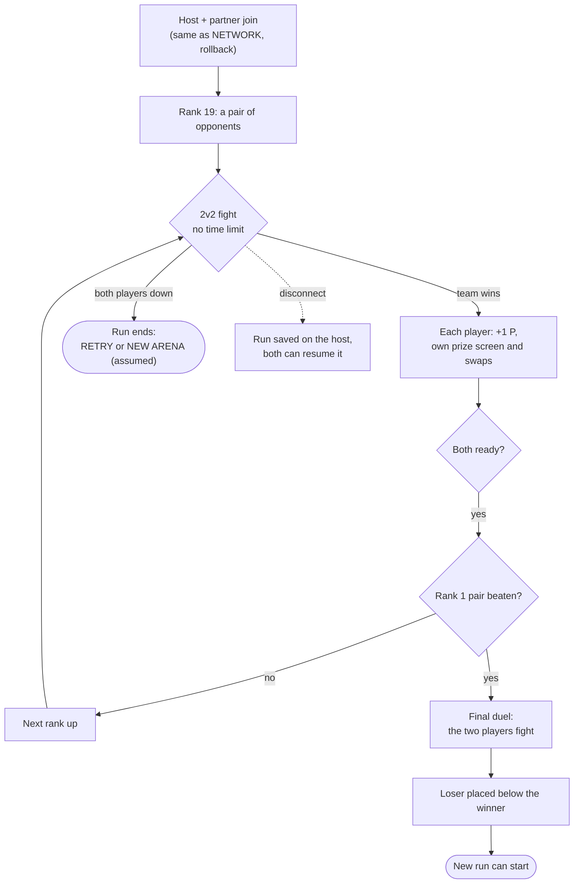

# Rogue Arena co-op (2 players)

Design for two players running Rogue Arena together online. Nothing built
yet. It builds on Rogue Arena (`src/gen1/acr_gen1_rogue.{h,c}`,
`src/platform/sdl3/rogue.c`), 4-AC battles, AI pilots inside online
matches and online joining (see [ROADMAP.md](ROADMAP.md) and
[NETPLAY.md](NETPLAY.md)).

## A run

## Rules

- **Two players, online:** one host and one partner, using the same joining
  as NETWORK (rollback netplay).
- **Every rank is a pair:** each rung of the ladder is two opponents, and
  the two players fight that pair together (a 2v2).
- **Final duel:** when rank 1's pair is beaten, the two players fight each
  other. The loser is placed below the winner. Then a new run can start.
- **Points:** each win earns each player 1 P.
- **Everything is individual except the shared stash:** each player has
  their own AC, P, prize screens and garage. Parts saved for later go into
  one shared stash that either player can equip from. A part the other
  player is highlighting can't be highlighted or selected by you.
- **A destroyed AC:** that partner spectates the rest of the fight and
  comes back for the next match if the team wins.
- **No time limit:** a fight goes on until one side's units are all down.
  (Solo Rogue Arena has a two-minute round; this applies there too unless
  decided otherwise.)
- **Next round** starts only when both players have confirmed they're
  ready.
- **Disconnect:** the run is saved and both players can try it again.
- **The host keeps the run.** Whoever joins takes over the guest's AC, P
  and build, whether it's the same person as before or someone new.
- **Starts:** teams start side by side near P1's / P2's usual starts,
  mirrored across the stage. On Garden Plaza each AC gets its own square,
  facing the centre.
- **Friendly fire** is on, but lock-on never picks a teammate.

## Working assumptions (to confirm)

- ROGUE ARENA offers SOLO (as now) or CO-OP.
- Still 19 ranks, so 38 opponents from the 158 on the disc, paired on the
  same difficulty curve.
- Both players' ACs destroyed: the run ends for both; RETRY or NEW ARENA
  work as in solo.
- The spectating partner still gets their 1 P and prize screen after a won
  round.
- The host picks STAGE; each player uses their own GARAGE.
- The final duel is a normal 1v1 on the host's stage with both players'
  current builds; the winner takes rank 1.

## Work to do

1. **Rules:** no time limit; ladder of pairs; two players' runs plus a
   shared stash; final-duel step; results for both. Unit tests as
   `test_gen1_rogue`.
2. **Online:** the host's save holds the whole run; the handshake sends the
   guest's side to whoever joins. Resume after a disconnect. Ready / confirm
   from both. Stash lock. Menus sync as plain messages; only fights need
   rollback.
3. **Fights:** the pair's builds, colours and AI in fighters 2 and 3; start
   positions per stage; spectate view (follow your partner); bring the
   partner back next fight.
4. **Screens:** ROGUE ARENA > SOLO / CO-OP; host / join like NETWORK; the
   ladder shows pairs; whose turn on the prize screen; the stash in SWAP
   PARTS.
5. **Play-test** on two PCs.
