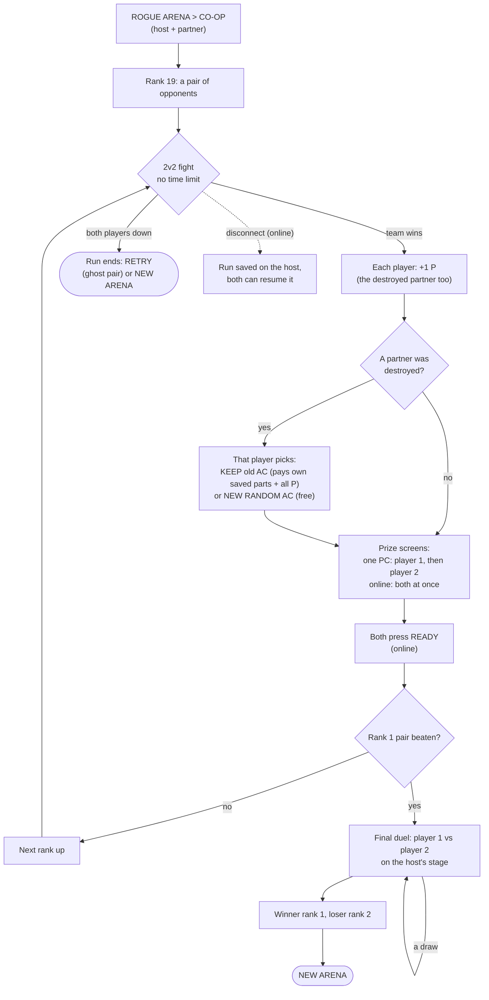

# Rogue Arena co-op (2 players)

Two players running Rogue Arena together. It builds on Rogue Arena
(`src/gen1/acr_gen1_rogue.{h,c}`, `src/platform/sdl3/rogue.c`), 4-AC
battles, AI pilots inside matches and online joining (see
[ROADMAP.md](ROADMAP.md) and [NETPLAY.md](NETPLAY.md)).

**Status (2026-11-25):** the rules and the whole run work **on one PC
with two controllers** (branch `rogue-coop`) and **online** (branch
`rogue-coop-online`, on top of it). Next: a play-test on two PCs.

## A run

## Rules

- **Two players:** one host and one partner, on one PC (split screen) or
  online: they join as in NETWORK (rollback netplay). Either way it's the
  host's run (the same files), so a run started on one PC can go on online
  and back. (User, 2026-11-25: "split screen or online co-op".)
- **ROGUE ARENA** asks **SOLO** (as before) or **CO-OP (2 PLAYERS)**.
  (Confirmed 2026-11-25.)
- **Every rank is a pair:** still 19 ranks, so 38 of the disc's arena
  opponents, drawn on the solo ladder's difficulty curve and paired
  easiest first. The rules that count ranks count pairs: KARASAWA users
  only in the top 10 pairs, Human PLUS users in the top 8, the tight top
  8. Nine-Ball (main arena rank 1) sits out, as in solo. (Confirmed.)
- **Starts:** each player gets their own random legal AC with a real gun,
  at 0 P, as in solo. (Confirmed: "like solo".)
- **No time limit:** a fight goes on until one side's ACs are all down.
  **Solo Rogue Arena has no time limit now too** (user, 2026-11-25).
- **Points:** each win earns each player 1 P (plus their +1 P PER WIN),
  including a partner who was destroyed in that fight. (Confirmed.)
- **A destroyed AC:** that player watches their partner (the view follows
  the partner) until the fight ends. If the team wins, they rejoin and
  choose (user, 2026-11-25):
  - **KEEP YOUR AC:** costs every part *that player* saved in the stash
    and all of their P. The partner's parts and P are untouched.
  - **NEW RANDOM AC:** free; their P and saved parts stay. Upgrades they
    bought (HUMAN PLUS, ALL OPTIONS, +1 P PER WIN) stay with the player.
  - The same rule for the host and the guest. The choice comes before the
    prize screens (so P can't be spent first and dodged).
- **Prize screens:** each player has their own (solo's screen, the same
  offers rules). On one PC player 1 first, then player 2; **online both at
  once**, each on their own PC (user, 2026-11-25).
- **Only the destroyed player** gets the KEEP / NEW RANDOM AC choice after
  a win (user, 2026-11-25); the other goes straight to their prize screen.
- **Names:** online, player 2 shows as their NETWORK name (the pilot and
  AC names in their garage); on one PC, PLAYER 2 / PARTNER (user,
  2026-11-25).
- **Everything is individual except the shared stash:** each player has
  their own AC, P, prize screens and upgrades. Parts saved for later go
  into one shared stash (room for 48, what both could save in solo), each
  marked with who saved it; either player can equip any of them in SWAP
  PARTS (the copy changes hands). A part the other player is highlighting
  can't be highlighted or taken by you.
- **Both players down:** the run ends for both. **RETRY** keeps the 19
  pairs, gives both new random ACs at 0 P, empties the stash, and leaves
  the losing duo on the ladder as a **ghost pair** at the rank it held
  (each with the AI of the opponent it pushed down), as in solo. **NEW
  ARENA** makes a new ladder. (Confirmed: "like solo".)
- **The host picks STAGE.** (Confirmed.) Each player's GARAGE: not in
  co-op yet (SWAP PARTS does the part changes).
- **Final duel:** when rank 1's pair is beaten, the two players fight a
  normal 1v1 on the host's stage with their current builds; no prize
  screen first. The winner takes rank 1, the loser rank 2. A draw is
  fought again. (Confirmed.)
- **Starts in a fight:** each team at its side's start, side by side, 500
  apart (`coop_spawn`, as co-op netplay).
- **Friendly fire** is on, but lock-on never picks a teammate.
- **Next round** starts when both players are done (rejoin choice and
  prize screens). Online, both press **READY** on the hub (NEXT BATTLE is
  READY there; pressing it again cancels); the fight starts 3 seconds
  after the second READY. The final duel is the same.
- **Disconnect (online):** the run is saved on the host and both can try
  it again. **The host keeps the run.** Whoever joins takes over the
  guest's AC, P and build, whether it's the same person or someone new.
  A fight that is cut off (a player leaves, gives up with Esc twice, or
  the connection is lost) doesn't count: the run is as it was before it.

## Online

- **Starting:** the host picks NETWORK > MODE **ROGUE ARENA CO-OP** (or
  ROGUE ARENA > CO-OP > PLAY ONLINE, which opens NETWORK with it picked)
  and hosts on the network or online with a mission briefing; the other
  player joins as in NETWORK (the list marks it ROGUE ARENA CO-OP). Both
  PCs need the same disc import: the arena opponents and the four stages
  are checked too.
- **The host chooses** on the co-op menu: CONTINUE the saved run, RETRY,
  NEW ARENA or LEAVE. The guest waits meanwhile ("THE HOST IS CHOOSING").
- **Each PC shows its own player:** your rejoin choice, your prize screen,
  SWAP PARTS for your own AC (the shared stash: a part your partner is
  highlighting is marked PARTNER ON IT and can't be taken). The hub says
  what your partner is doing (choosing, on the prize screen, ready).
- **The host picks STAGE**; the guest's STAGE row says so.
- **Fights:** each PC shows its own player full screen; when you're down
  the view follows your partner. The pair's pilots fly inside the match
  on both PCs, so only the two players' controls cross the network
  (rollback, as NETWORK). No time limit. The host ends the fight once every
  step of it is confirmed and sends the result.
- **Leaving:** LEAVE on the hub (or the co-op menu), or Esc twice in a
  fight. The other PC shows why the session ended; the host's run is saved.

### How it works

- The host's run is the run: its files, its rules
  (`src/gen1/acr_gen1_coop.c`). After every change it sends the guest the
  whole run as text (`acr_gen1_coop_state_write`: the run file, both
  garages and the stash lock, about 4 KB). The guest keeps a copy and
  never saves it; leaving brings back its own one-PC run.
- What the guest does goes to the host as a message, and the host applies
  it with the same rules and sends the run back: the rejoin choice, its
  side after its prize screen (`acr_gen1_coop_side_write`: garage, P,
  prize state, upgrades, parts saved for later, which the host then puts in
  the stash), the stash part it highlights and takes (named by category,
  part and owner, so a stash that moved on can't mix them up), READY.
- The messages (`src/net/acr_msg.{h,c}`, tested in `tests/test_msg.c`):
  whole messages in order over UDP, cut into 200-byte chunks with running
  numbers, each sent again every 250 ms until the other side's ack says
  it arrived; a keep-alive once a second. The same socket as the fights
  (`net_link_msg_send` / `_recv`, packets "ACRM"). The list of messages
  is at the top of `src/platform/sdl3/rogue_coop_net.inc`.
- Fights: both PCs build the fight from the same run (the host's seed in
  the start message) and run it with `acr_rollback` as NETWORK does; the
  pair's AI pilots are the match's (`rules.ai_mask`, `rules.ai[]`).

## Where it lives

- Rules: `src/gen1/acr_gen1_coop.{h,c}` (no OS calls), the paired ladder
  in `acr_gen1_rogue_lineup_pairs` (`acr_gen1_rogue.c`, sharing solo's
  draw; solo's ladders are unchanged). Each player's side is a solo run
  (`acr_gen1_rogue`), so prizes, SWAP PARTS checks and upgrades are the
  solo rules. Tests: `tests/test_gen1_coop.c` (made-up parts and
  opponents, shared with the solo test in `tests/gen1_rogue_fixture.h`).
- Screens: `src/platform/sdl3/rogue_coop.inc`, included by `rogue.c` so it
  shares its drawing, sounds, stage list and the prize screen (co-op
  lends a player's side to the solo prize screen, then takes it back).
- Fights: `main.c` (Rogue Arena co-op fight = `g_rogue_fight` 3): player 1
  fighter 0, player 2 fighter 1 on the second controller, the pair
  fighters 2 and 3 flown by their own pilots and Human PLUS levels.
- Files beside the save: `rogue-coop-run.toml` (the run: ladder, ghosts,
  stash with owners, each player's P and prize state) and
  `rogue-coop-p1.toml` / `rogue-coop-p2.toml` (each player's garage).
- Online: `src/platform/sdl3/rogue_coop_net.inc` (the session, messages,
  READY, starting fights), `src/net/acr_msg.{h,c}` (the message
  channel), the ROGUE ARENA CO-OP mode in `net_link` / `net_menu`
  (protocol version 4) and the online fight in `main.c` (look for
  `rf->online`).

## Try it (one PC)

1. Plug in two controllers (player 1 can use the keyboard instead).
2. Main menu > ROGUE ARENA > CO-OP (2 PLAYERS) > NEW ARENA.
3. NEXT BATTLE > fight the pair together on the split screen.
4. After a win: a destroyed partner picks KEEP / NEW RANDOM AC; then
   PLAYER 1 PRIZE, then PLAYER 2 PRIZE (SAVE FOR LATER puts parts in the
   shared stash: SWAP PARTS, left / right picks whose AC).
5. Testing aids: `ACR_ROGUE_AUTOWIN=1` wins every fight,
   `ACR_ROGUE_DOWN=2` (or 1, or 12) marks that player destroyed in it,
   `ACR_ROGUE_SEED=...` fixes the ladder.

## Try it (online, two PCs or two copies on one PC)

1. Both PCs: the same disc imported (each player's own garage names are
   their NETWORK names).
2. Host: NETWORK > MODE < ROGUE ARENA CO-OP > > HOST ON THIS NETWORK (or
   HOST ONLINE). Or ROGUE ARENA > CO-OP > PLAY ONLINE.
3. Other PC: NETWORK > pick the game marked ROGUE ARENA CO-OP (or join by
   address / mission briefing).
4. Host: CONTINUE or NEW ARENA. Both: READY on the hub, fight together.
5. After a win, each answers their own screens at the same time, then
   READY again.
6. From a terminal: `armored-corer --host --rogue-coop` and
   `armored-corer --join 127.0.0.1` (two copies on one PC). With
   `ACR_ROGUE_AUTOWIN=1` on the host, the host wins each fight after 1.5 s
   (`ACR_ROGUE_DOWN=2` marks player 2 destroyed).

## Work to do

1. **Rules:** ~~no time limit; ladder of pairs; two players' runs plus a
   shared stash and its lock; rejoin choice; final duel; results for
   both; save / resume.~~ Done 2026-11-25.
2. **Online:** ~~the host's save holds the whole run; whoever joins takes
   over the guest's side; resume after a disconnect; ready from both; the
   stash lock over the link; menus as plain messages, fights on
   rollback~~. Done 2026-11-25 (branch `rogue-coop-online`).
3. **Fights:** ~~the pair's builds, colours, AI and Human PLUS in fighters
   2 and 3; spectate view (follow your partner); bring the partner back
   next fight~~ (done, one PC). Still to do: Garden Plaza's own starts
   (each AC its own square, facing the centre); each player's options
   (ALL OPTIONS) in the fight (the engine doesn't use options in fights
   yet, solo included).
4. **Screens:** ~~ROGUE ARENA > SOLO / CO-OP; the ladder shows pairs;
   whose turn on the prize screen; the stash in SWAP PARTS; rejoin; duel;
   results; host / join like NETWORK; player 2's own names online~~
   (done). Still to do: each player's GARAGE in co-op; co-op VS and victory
   screens in solo's style (3D ACs, emblems).
5. **Play-test** on one PC with two controllers, then on two PCs.
