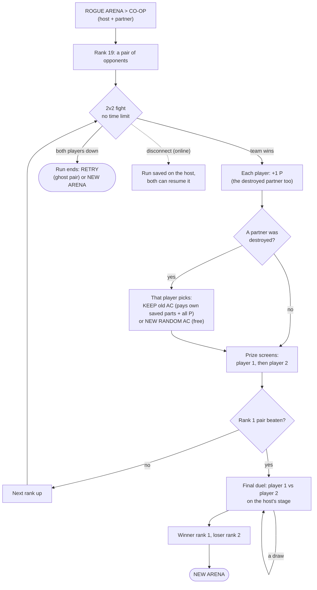

# Rogue Arena co-op (2 players)

Two players running Rogue Arena together. It builds on Rogue Arena
(`src/gen1/acr_gen1_rogue.{h,c}`, `src/platform/sdl3/rogue.c`), 4-AC
battles, AI pilots inside matches and online joining (see
[ROADMAP.md](ROADMAP.md) and [NETPLAY.md](NETPLAY.md)).

**Status (2026-11-25):** the rules and the whole run work **on one PC
with two controllers** (branch `rogue-coop`). Online comes next.

## A run

## Rules

- **Two players:** one host and one partner. Online they join as in
  NETWORK (rollback netplay); for now both play on one PC.
- **ROGUE ARENA** asks **SOLO** (as before) or **CO-OP (2 PLAYERS)**.
  (Confirmed 2026-11-25.)
- **Every rank is a pair:** still 19 ranks, so 38 of the disc's arena
  opponents, drawn on the solo ladder's difficulty curve and paired
  easiest first. The rules that count ranks count pairs: KARASAWA users
  only in the top 10 pairs, Human PLUS users in the top 8, the tight top
  8. Nine-Ball (main arena rank 1) sits out, as in solo. (Confirmed.)
- **Starts:** each player gets their own random legal AC with a real gun,
  at 0 P, as in solo. (Confirmed: "like solo".)
- **No time limit:** a fight goes on until one side's ACs are all down.
  **Solo Rogue Arena has no time limit now too** (user, 2026-11-25).
- **Points:** each win earns each player 1 P (plus their +1 P PER WIN),
  including a partner who was destroyed in that fight. (Confirmed.)
- **A destroyed AC:** that player watches their partner (the view follows
  the partner) until the fight ends. If the team wins, they rejoin and
  choose (user, 2026-11-25):
  - **KEEP YOUR AC:** costs every part *that player* saved in the stash
    and all of their P. The partner's parts and P are untouched.
  - **NEW RANDOM AC:** free; their P and saved parts stay. Upgrades they
    bought (HUMAN PLUS, ALL OPTIONS, +1 P PER WIN) stay with the player.
  - The same rule for the host and the guest. The choice comes before the
    prize screens (so P can't be spent first and dodged).
- **Prize screens:** each player has their own (solo's screen, the same
  offers rules), player 1 first, then player 2.
- **Everything is individual except the shared stash:** each player has
  their own AC, P, prize screens and upgrades. Parts saved for later go
  into one shared stash (room for 48, what both could save in solo), each
  marked with who saved it; either player can equip any of them in SWAP
  PARTS (the copy changes hands). A part the other player is highlighting
  can't be highlighted or taken by you.
- **Both players down:** the run ends for both. **RETRY** keeps the 19
  pairs, gives both new random ACs at 0 P, empties the stash, and leaves
  the losing duo on the ladder as a **ghost pair** at the rank it held
  (each with the AI of the opponent it pushed down), as in solo. **NEW
  ARENA** makes a new ladder. (Confirmed: "like solo".)
- **The host picks STAGE.** (Confirmed.) Each player's GARAGE: not in
  co-op yet (SWAP PARTS does the part changes).
- **Final duel:** when rank 1's pair is beaten, the two players fight a
  normal 1v1 on the host's stage with their current builds; no prize
  screen first. The winner takes rank 1, the loser rank 2. A draw is
  fought again. (Confirmed.)
- **Starts in a fight:** each team at its side's start, side by side, 500
  apart (`coop_spawn`, as co-op netplay).
- **Friendly fire** is on, but lock-on never picks a teammate.
- **Next round** starts when both players are done (rejoin choice and
  prize screens). Online, both confirm ready.
- **Disconnect (online):** the run is saved on the host and both can try
  it again. **The host keeps the run.** Whoever joins takes over the
  guest's AC, P and build, whether it's the same person or someone new.

## Where it lives

- Rules: `src/gen1/acr_gen1_coop.{h,c}` (no OS calls), the paired ladder
  in `acr_gen1_rogue_lineup_pairs` (`acr_gen1_rogue.c`, sharing solo's
  draw; solo's ladders are unchanged). Each player's side is a solo run
  (`acr_gen1_rogue`), so prizes, SWAP PARTS checks and upgrades are the
  solo rules. Tests: `tests/test_gen1_coop.c` (made-up parts and
  opponents, shared with the solo test in `tests/gen1_rogue_fixture.h`).
- Screens: `src/platform/sdl3/rogue_coop.inc`, included by `rogue.c` so it
  shares its drawing, sounds, stage list and the prize screen (co-op
  lends a player's side to the solo prize screen, then takes it back).
- Fights: `main.c` (Rogue Arena co-op fight = `g_rogue_fight` 3): player 1
  fighter 0, player 2 fighter 1 on the second controller, the pair
  fighters 2 and 3 flown by their own pilots and Human PLUS levels.
- Files beside the save: `rogue-coop-run.toml` (the run: ladder, ghosts,
  stash with owners, each player's P and prize state) and
  `rogue-coop-p1.toml` / `rogue-coop-p2.toml` (each player's garage).

## Try it (one PC)

1. Plug in two controllers (player 1 can use the keyboard instead).
2. Main menu > ROGUE ARENA > CO-OP (2 PLAYERS) > NEW ARENA.
3. NEXT BATTLE > fight the pair together on the split screen.
4. After a win: a destroyed partner picks KEEP / NEW RANDOM AC; then
   PLAYER 1 PRIZE, then PLAYER 2 PRIZE (SAVE FOR LATER puts parts in the
   shared stash: SWAP PARTS, left / right picks whose AC).
5. Testing aids: `ACR_ROGUE_AUTOWIN=1` wins every fight,
   `ACR_ROGUE_DOWN=2` (or 1, or 12) marks that player destroyed in it,
   `ACR_ROGUE_SEED=...` fixes the ladder.

## Work to do

1. **Rules:** ~~no time limit; ladder of pairs; two players' runs plus a
   shared stash and its lock; rejoin choice; final duel; results for
   both; save / resume.~~ Done 2026-11-25.
2. **Online:** the host's save holds the whole run (done: one file plus
   both garages); the handshake sends the guest's side to whoever joins;
   resume after a disconnect; ready / confirm from both; the stash lock
   over the link; menus sync as plain messages, only fights need rollback.
3. **Fights:** ~~the pair's builds, colours, AI and Human PLUS in fighters
   2 and 3; spectate view (follow your partner); bring the partner back
   next fight~~ (done, one PC). Still to do: Garden Plaza's own starts
   (each AC its own square, facing the centre); each player's options
   (ALL OPTIONS) in the fight (the engine doesn't use options in fights
   yet, solo included).
4. **Screens:** ~~ROGUE ARENA > SOLO / CO-OP; the ladder shows pairs;
   whose turn on the prize screen; the stash in SWAP PARTS; rejoin; duel;
   results~~ (done). Still to do: host / join like NETWORK; each player's
   GARAGE in co-op; player 2's own names (on one PC: PLAYER 2 / PARTNER);
   co-op VS and victory screens in solo's style (3D ACs, emblems).
5. **Play-test** on one PC with two controllers now, then on two PCs.
