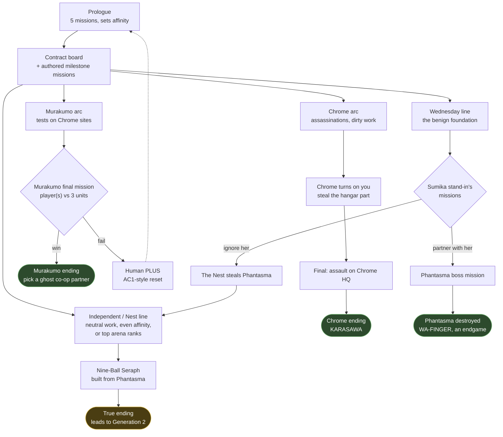
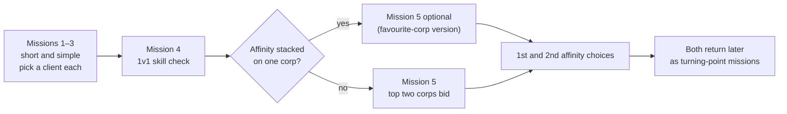
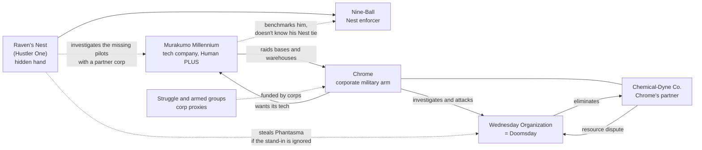
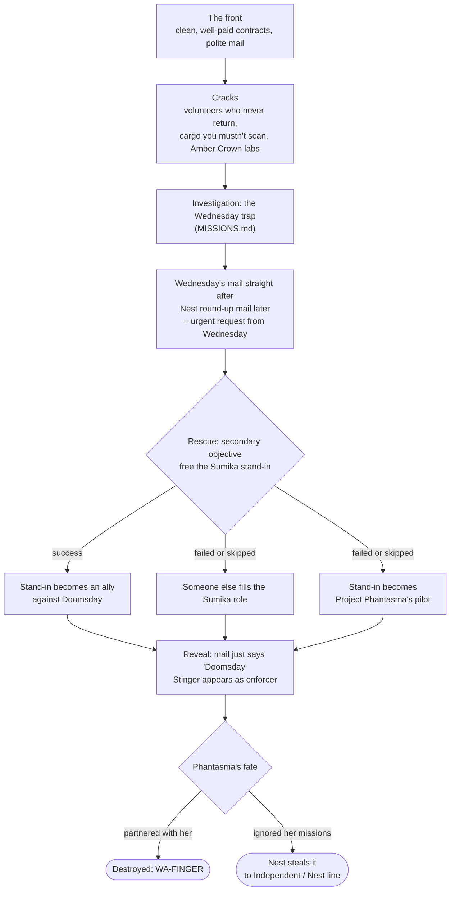
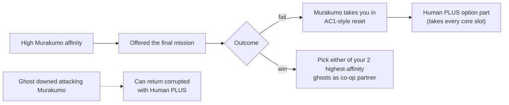

# Story map (Gen 1 campaign)

The Gen 1 (Master of Arena) campaign as designed so far. Nothing here is
built yet. Lines marked **(proposed)** are ideas not yet agreed; everything
else is a decision. Related docs: [GHOSTS.md](GHOSTS.md) (ghost rivals,
contracts, affinity), [MISSIONS.md](MISSIONS.md) (mission ideas and
mockups).

The diagrams are [Mermaid](https://mermaid.js.org/); GitHub draws them on
the page, and editing the text inside the code block changes the picture.

## The shape of a run

A run isn't one fixed line. A short prologue sets the player's
affinities, the contract board fills the time between authored milestone
missions, and which arc the player follows decides the ending. A linear
tree (Prologue → Chrome/Murakumo split → collapse → finale) was rejected:
it always ends in the same place, so replays don't feel different and the
player's impact doesn't show in the lore.

- **The true ending** is completing the Independent / Nest line. It leads
  to Generation 2.
- The game **pushes players toward the other endings** first: neutral work
  is scarce and pays little early on, the corps court harder, and the Nest
  trap opens only once its conditions are met.
- **Repeat runs** lock the Wednesday path (no new Sumika appears), so the
  independent ending gets easier to reach.
- **Arena route on a first run:** arena wins count toward Independent
  affinity, but only sway the endgame if the player reaches the top ranks.
  Endings reset that run's affinities but not arena rank, so the arena
  route can't be earned twice.
- **Switching sides:** a run offers about 2–3 real chances to defect (a
  mid-mission counteroffer, a client's betrayal, intel used as leverage,
  double-agent work). See [GHOSTS.md](GHOSTS.md#switching-sides).

## Prologue and affinity

- **Points per contract (proposed):** directly against a rival +2 client,
  −1 rival; unrelated filler +1 client; neutral work (city guards, arena,
  Nest-direct) +2 Independent.
- **Independent** is reached through neutral work, or with the top two corp
  tracks within a point of each other.
- An **affinity graphic** for the current run is shown on the mission
  screen or in the garage. A hidden **lifetime tally** keeps building
  across runs and hardens the player's own ghost's allegiance toward one
  corp.

## Who's who

- **Chrome vs Murakumo** is the tension between the big two. Chrome wants
  Murakumo's tech; Murakumo wants to stay independent. Murakumo's mission
  targets are only Chrome bases and warehouses, hit to test new gear and to
  retaliate.
- **Murakumo is Icarus.** It bases Human PLUS on Nine-Ball firing his
  grenade launcher without crouching, and sees him as a rival and a
  benchmark, the machine to beat.
- **Nine-Ball's rules:** he doesn't kill Ravens on purpose unless they fall
  out of line or are an active threat.
- **City guards** only appear as ordinary clients on the contract board.

## Wednesday / Doomsday arc

Project Phantasma's organization first appears under its Japanese-release
name, the **Wednesday Organization**, wearing a false, benign image. It is
later revealed, with no announcement, to be **Doomsday**.

- **The Sumika role is always filled; who fills it can change.** The
  stand-in is a friendly ghost that hasn't had a big role yet (never a
  close-player ghost, rival or current partner). If no ghost fits, an
  authored NPC Raven takes it.
- Ghosts never disappear as a warning sign.
- **Supporting Doomsday** routes into the Independent / Nest line.
- **Ignored stand-in (proposed):** she can be eliminated in the
  background. A Nest mail reports it and her rank entry is greyed out,
  the one exception to the no-ghost-mail rule.
- **Completing her path:** she can wingman in future runs; after a full
  clear with her she's promoted to an NPC (skills locked, can't betray,
  never deleted).

## Murakumo and Human PLUS

- Murakumo's arc is the **only** path to Human PLUS.
- Enemies and ghosts get PLUS for free (a slight edge); for the player it's
  an option part.
- **PLUS ghosts** get a special booster colour or trail but keep their
  emblem and paint. Formerly loyal to Murakumo: composed and loyal.
  Otherwise: erratic and random.
- **Final mission:** player(s) against 3 dedicated units. A solo player's
  highest-affinity ghost joins midway for free.
- **Mid-run pressure (proposed):** the Nest and a partner corp investigate
  the pilots going missing around Murakumo. Beating the task force's top
  AC protects Murakumo's secret and settles the Murakumo path.

## Chrome arc

1. **Proving useful:** assassinations and dirty work.
2. **Turning point:** once you've proved too useful, Chrome turns on you.
3. **The hunt:** several companies, Chrome included, send their best ACs.
4. **The betrayal steal:** a unique option part that adds an AC6-style
   hangar (four hand weapons, spares in the back slots, about 1 s to swap).
5. **Final mission:** plant bombs across Chrome HQ while paired ACs chase
   you. Beating them is optional. The chasers are ghosts due for removal,
   toned down. Reward: the KARASAWA plus the hangar part.

**Mid-run boss (proposed):** defeating Struggle's leader (reward LS-99
MOONLIGHT) for Chrome settles the Chrome path.

## Endgame bosses

- **Project Phantasma:** just a mission on the board. If the player picks
  another mission instead, the Nest steps in, sends someone else, and the
  run heads into the Nest path.
- **Nine-Ball Seraph:** beating it is an ending. When the stand-in is
  ignored, the Nest builds Seraph from the stolen Phantasma.
- Every endgame reward is issued once and is a permanent unlock; reward
  weapons can be sold and bought back.

## Open questions

- The endings list: the earlier plan named Chrome rule, Murakumo rule,
  Nest exposed and mutual collapse; the later plan names Chrome,
  Wednesday, Murakumo and Independent / Nest (true). Which set is current?
- What is Wednesday's urgent request after the Investigation? Does
  declining lock the player out of Wednesday, or only cost affinity?
- Who is the Nest's partner corp in the Murakumo investigation?
- What was Nine-Ball destroying at the lab, and why did the Nest want it
  gone? (Answered later, on the Nest line.)
- Which arena rank counts as "top ranks" for swaying the endgame?
